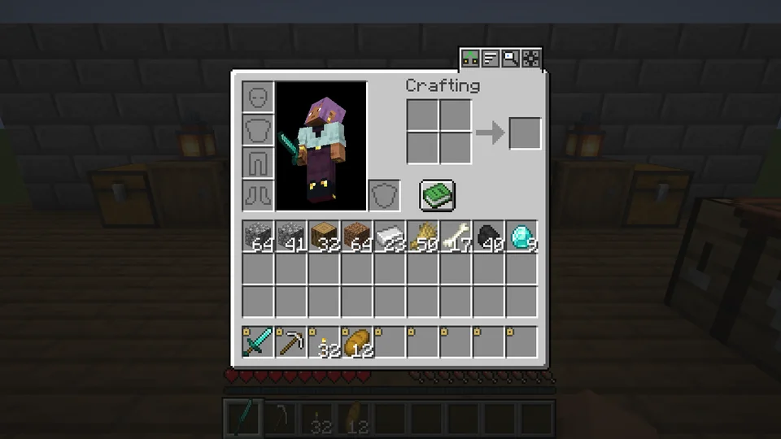
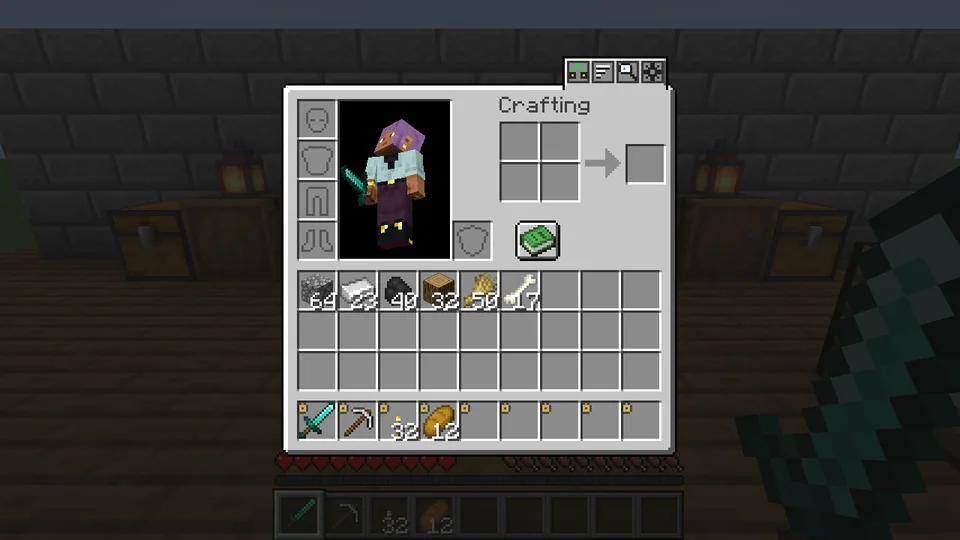
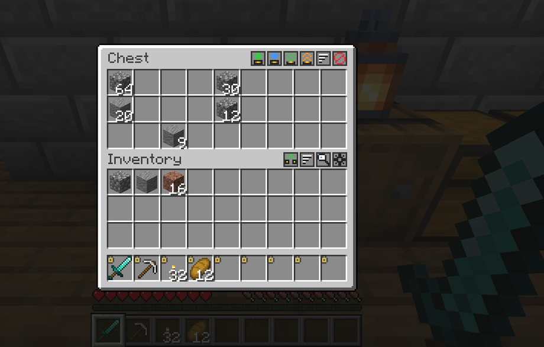
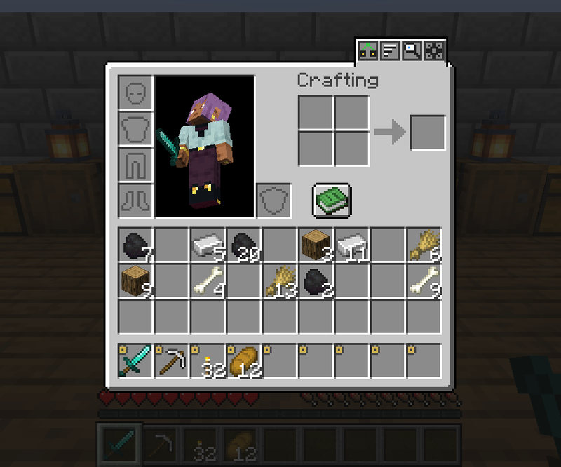
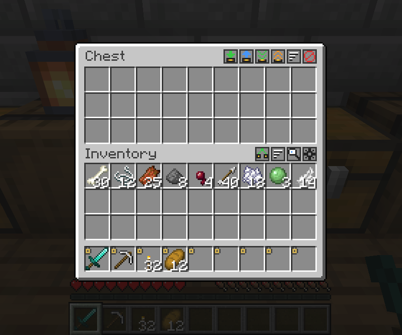
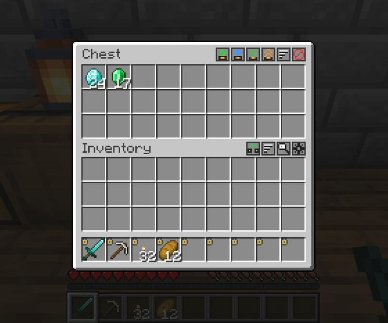
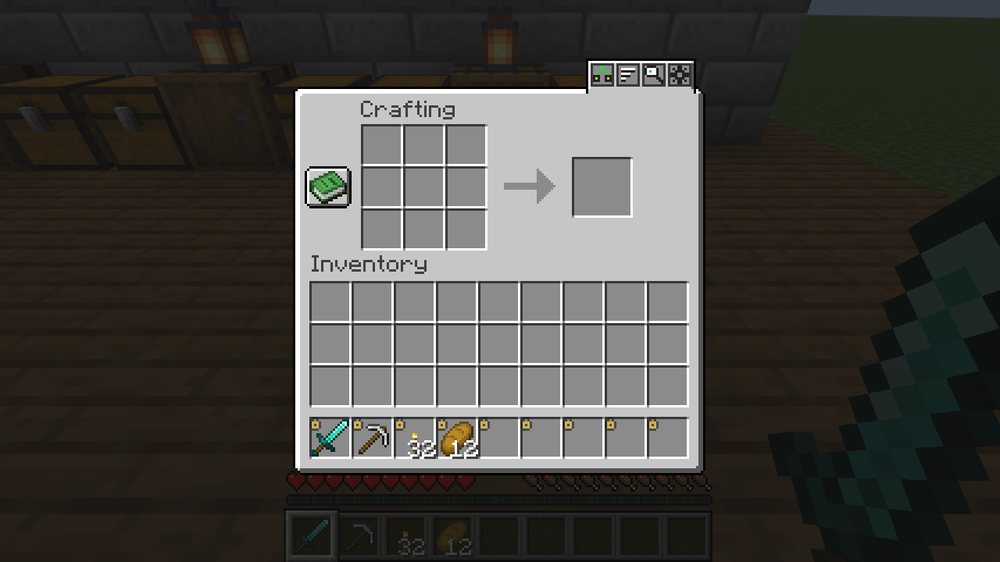
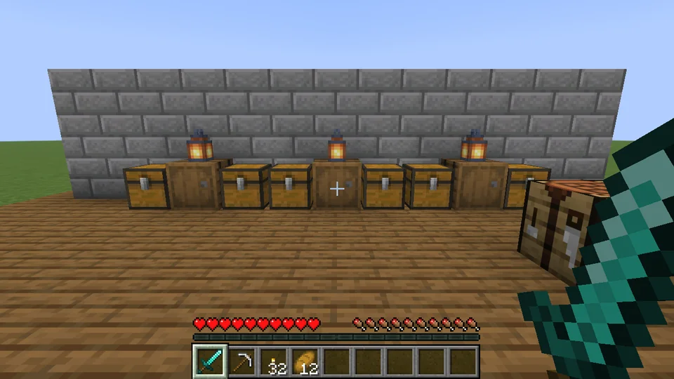

**English** · [Українська](README.uk.md)

<p align="center">
  
</p>

<h1 align="center">QuickStack</h1>

<p align="center">
  <b>Terraria-style inventory management for Minecraft.</b><br>
  Press <kbd>Z</kbd> and watch your loot fly into the chests that already hold it.
</p>

<p align="center">
  
  
  
  
  
</p>

<p align="center">
  
</p>

---

## Features

### Quick stack to nearby chests
Press <kbd>Z</kbd> or the button in your inventory. The inventory closes, your items burst out in front of you and
fly one by one into the nearby chests, barrels and shulker boxes that already contain the same item. Chests open
their lids as the items land.

### Locked slots
<kbd>Alt</kbd> + click a slot to lock it. Locked slots never leave — not by quick stack, not by *deposit all*, not by
sorting. The hotbar starts locked; armour and offhand are never touched.

<p align="center"></p>

### Chest buttons
Every chest, barrel and shulker box gets a row of small buttons: **quick stack into this chest**, **restock**
(take what you carry, leave 1 of each behind — configurable), **deposit all**, **loot all**, **sort** and
**exclude** the chest from quick stack to nearby.

<p align="center"></p>

### Sorting
Sort your inventory or any chest with a button, a key or a middle click — by category, name or count. Partial stacks
are merged; locked slots stay where they are.

<p align="center"></p>

<table>
<tr>
<td width="50%" valign="top">

### Shift sweep
Hold <kbd>Shift</kbd> + left mouse button and sweep over slots: each one you pass is shift-clicked into the other
inventory.



</td>
<td width="50%" valign="top">

### Mouse wheel, one item at a time
Wheel up over a stack picks up one more item, wheel down puts one back — like right clicks, only faster.



</td>
</tr>
</table>

### Crafting from nearby chests
The recipe book counts the items in chests around you, and the crafting grid takes missing ingredients straight from
them. Whatever is left over goes back to the chest it came from when you close the table.

<p align="center"></p>

### Find items
<kbd>F6</kbd> opens a grid of everything stored in the chests around you. Type to filter, click an item, and the
chests holding it light up with a column of sparkles you can see through walls.

<p align="center"></p>

### Undo
Stacked the wrong thing? Bind the *Undo* key and take the last quick stack back.

## Controls

| Action | Default |
|---|---|
| Quick stack to nearby chests | <kbd>Z</kbd> (also the inventory button) |
| Lock / unlock a slot | <kbd>Alt</kbd> + click |
| Sort the inventory or the chest under the cursor | middle click, button, or a key (unbound) |
| Shift sweep | <kbd>Shift</kbd> + left button, move over slots |
| Take / put one item | mouse wheel up / down over a slot |
| Find an item in nearby chests | <kbd>F6</kbd> |
| Undo the last quick stack | unbound |
| Settings | gear button in the inventory, Mod Menu, or the NeoForge mods list |

All keys can be changed in *Options → Controls → QuickStack*.

## Download and install

| | |
|---|---|
| Minecraft | **1.21.6 – 1.21.8** |
| Loader | **Fabric** (with [Fabric API](https://modrinth.com/mod/fabric-api)) or **NeoForge** |
| Side | **client and server** — singleplayer works out of the box |
| Optional | [Mod Menu](https://modrinth.com/mod/modmenu) (Fabric) for the settings button in the mod list |

Get the jar for your loader from [Releases](https://github.com/ifoxp/QuickStack-Minecraft/releases) and put it in
your `mods` folder. A CurseForge page is on its way.

Older versions (1.21.1 and newer) are planned once the 26.3 version settles.

## Settings

Everything can be changed in game. Your own preferences are stored in `config/quickstack-client.json`: what restock
leaves in the chest, the flying animation, button placement, sort order, shift sweep mode, the mouse wheel and more.
In singleplayer a second tab sets the world limits, stored in `config/quickstack-server.json`: quick stack, crafting
and search radius, landing rate, cooldown, undo window, crafting from nearby and modded chests.

## How it works and why it does not lag

The server does every transfer. When you press <kbd>Z</kbd> it plans the whole quick stack at once — simulated inserts
on copies of the chests, so nothing is sent to a chest that is full — takes the items out of your inventory, and lets
them land on their arrival tick, a few per tick. A landing re-checks the chest, and anything that no longer fits comes
back to you; disconnecting or stopping the server lands everything at once, so items are never lost in the air. The
flying items are client-side visuals only.

Nearby chests are found through the block entity lists of chunks that are already loaded — no block scanning and no
chunk loading. Stress test, radius 16, **2 352 chests holding 61 152 full stacks** and a full inventory:

| | |
|---|---|
| Finding the chests | 5 ms |
| Planning the quick stack | 7 ms (16 ms on the very first run) |
| Worst server tick while 36 stacks land | 4.8 ms (2.5 ms without the mod) |

## Compatibility

- Modded chests that behave like vanilla containers (18 or more slots) work automatically.
- Unopened loot chests are never touched, so their loot is not generated early.
- Locked containers (vanilla lock component) are skipped.
- On a server without QuickStack the mod stays quiet and tells you it is not installed there.

## Languages

English, Українська, Deutsch, Français, Español, Português (Brasil), Italiano, Polski, Čeština, Türkçe, Nederlands,
日本語, 한국어, 简体中文, 繁體中文, Қазақша, Oʻzbekcha, Кыргызча, Azərbaycanca, Հայերեն, ქართული, Lietuvių,
Latviešu, Eesti, Română, Монгол.

Spotted a clumsy translation? Issues and pull requests are welcome — the files live in
[`common/src/main/resources/assets/quickstack/lang`](common/src/main/resources/assets/quickstack/lang).

## Building from source

Minecraft 1.21.6 – 1.21.8 needs **Java 21**.

```sh
./gradlew build -x javadoc                 # jars in fabric/build/libs and neoforge/build/libs
./gradlew :fabric:runClient                # dev client
./gradlew :fabric:runClientGameTest        # 45 scripted checks in a real client
```

The project follows the MultiLoader layout: `common/` holds all the logic, `fabric/` and `neoforge/` are thin
loader adapters (events, networking, saved data). The client gametests in `fabric/src/gametest` play the features
with real mouse clicks and keys, check the result on the server and include the 2 352-chest stress test.

## License

[MIT](LICENSE) © 2026 Chekaliuk Dmytro

## Author

**Chekaliuk Dmytro** · [@ifoxp](https://github.com/ifoxp) — developer from Ukraine 🇺🇦

[ifoxp.top](https://ifoxp.top) · Telegram [@ifoxp](https://t.me/ifoxp) · Discord `ifoxp`

If QuickStack saves you a few trips to the chest room, a ⭐ on the repository helps others find it.
