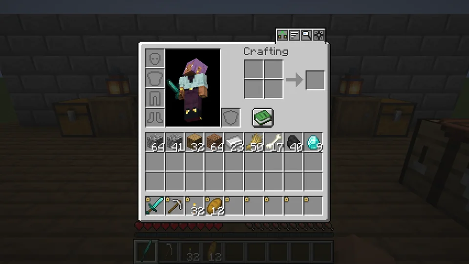
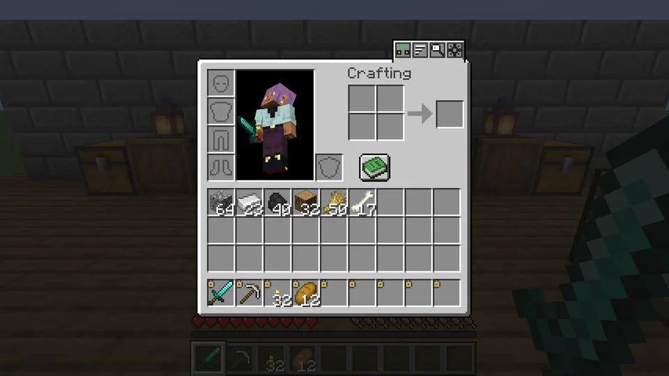
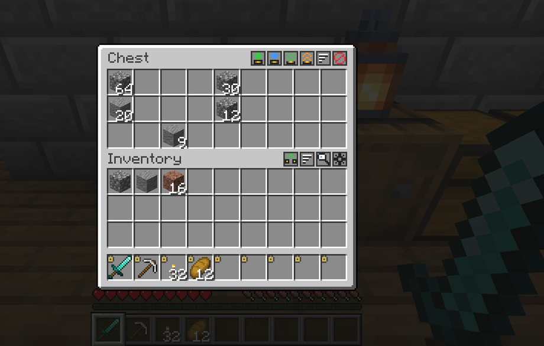
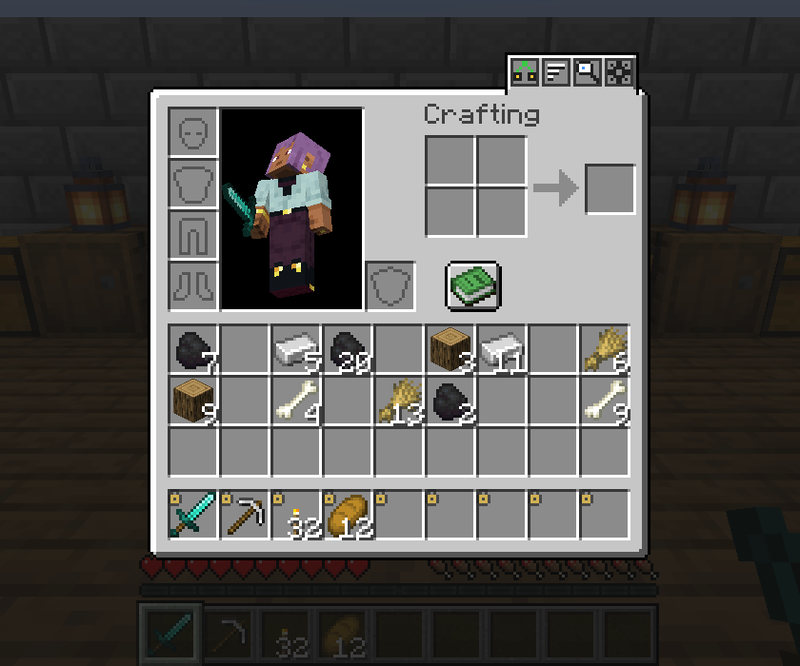
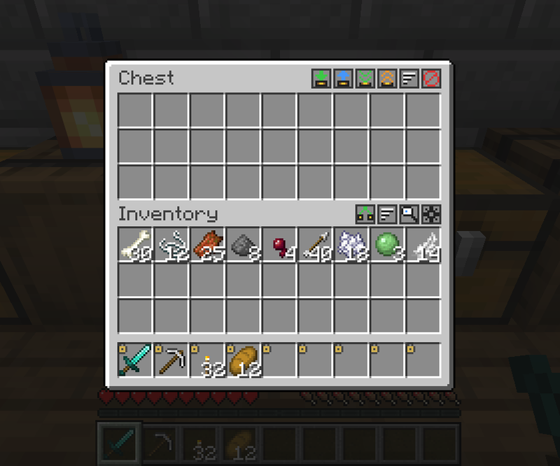
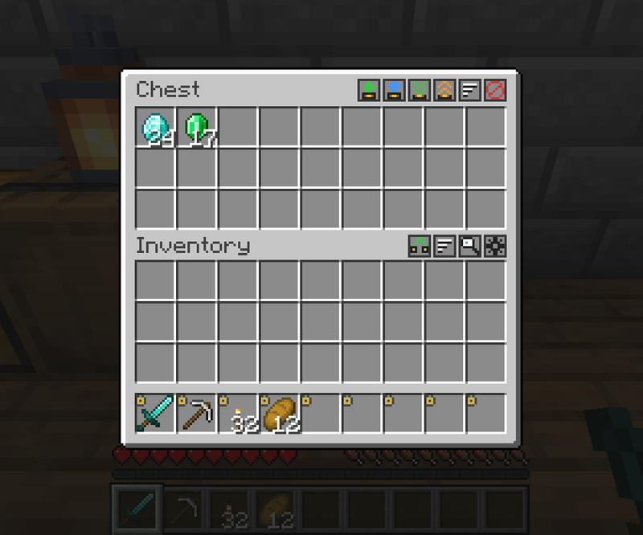
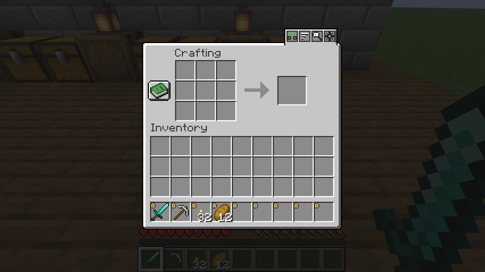
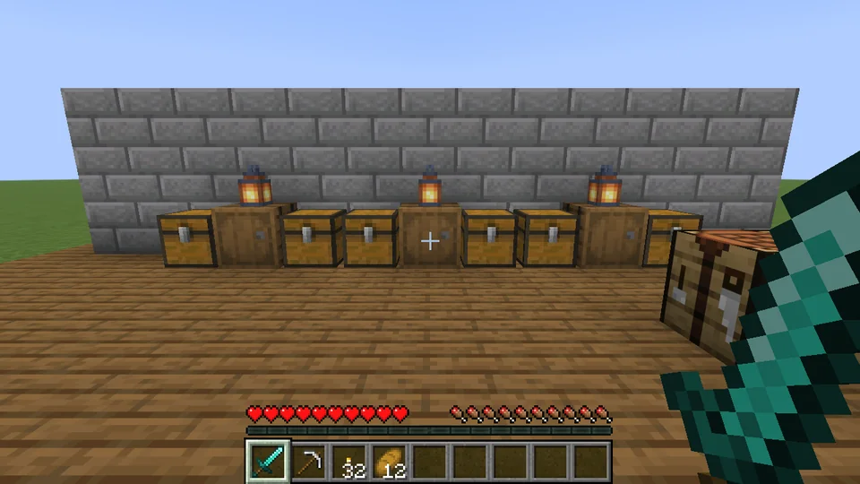

[English](README.md) · **Українська**

<p align="center">
  
</p>

<h1 align="center">QuickStack</h1>

<p align="center">
  <b>Керування інвентарем у стилі Terraria для Minecraft.</b><br>
  Натисни <kbd>Z</kbd> — і речі самі полетять у скрині, де такі вже лежать.
</p>

<p align="center">
  
  
  
  
  
</p>

<p align="center">
  
</p>

---

## Можливості

### Скласти в найближчі скрині
Натисни <kbd>Z</kbd> або кнопку в інвентарі. Інвентар закривається, речі вилітають перед тобою і по черзі летять у
скрині, бочки та шалкери поруч, де вже є такі самі предмети. Кришки відкриваються, коли предмети долітають.

### Фіксація слотів
<kbd>Alt</kbd> + клік по слоту фіксує його. Зафіксовані слоти нікуди не діваються: ні при складанні, ні при «покласти
все», ні при сортуванні. Хотбар зафіксований одразу; броню і другу руку мод не чіпає ніколи.

<p align="center"></p>

### Кнопки скрині
У кожної скрині, бочки й шалкера є рядок маленьких кнопок: **скласти в цю скриню**, **поповнити** (забрати те, що
вже є в інвентарі, лишивши по 1 — налаштовується), **покласти все**, **забрати все**, **сортувати** і **виключити**
скриню зі складання в найближчі.

<p align="center"></p>

### Сортування
Інвентар чи будь-яку скриню — кнопкою, клавішею або середньою кнопкою миші. За категорією, назвою чи кількістю.
Неповні стаки зливаються, зафіксовані слоти лишаються на місці.

<p align="center"></p>

<table>
<tr>
<td width="50%" valign="top">

### Протягування з Shift
Затисни <kbd>Shift</kbd> + ліву кнопку миші й веди по слотах — кожен слот переноситься, як від Shift+кліку.



</td>
<td width="50%" valign="top">

### Колесико — по одному предмету
Колесико вгору над стаком бере ще один предмет, вниз — кладе один назад. Як ПКМ, тільки швидше.



</td>
</tr>
</table>

### Крафт зі скринь поруч
Книга рецептів враховує предмети зі скринь навколо, а сітка крафту бере відсутні інгредієнти прямо з них. Те, що
лишилося, повертається в ту саму скриню, коли закриваєш верстак.

<p align="center"></p>

### Пошук предметів
<kbd>F6</kbd> відкриває сітку всього, що лежить у скринях навколо. Набирай назву, клікай предмет — і скрині з ним
підсвітяться стовпом іскор, який видно крізь стіни.

<p align="center"></p>

### Скасування
Склав не те? Признач клавішу «Скасувати» — і останнє складання повернеться.

## Керування

| Дія | За замовчуванням |
|---|---|
| Скласти в найближчі скрині | <kbd>Z</kbd> (і кнопка в інвентарі) |
| Зафіксувати / розфіксувати слот | <kbd>Alt</kbd> + клік |
| Сортувати інвентар чи скриню під курсором | середня кнопка, кнопка або клавіша (не призначена) |
| Протягування з Shift | <kbd>Shift</kbd> + ліва кнопка, вести по слотах |
| Взяти / покласти один предмет | колесико вгору / вниз над слотом |
| Знайти предмет у скринях поруч | <kbd>F6</kbd> |
| Скасувати останнє складання | не призначена |
| Налаштування | шестерня в інвентарі, Mod Menu або список модів NeoForge |

Усі клавіші змінюються в *Налаштування → Керування → QuickStack*.

## Завантаження і встановлення

| | |
|---|---|
| Minecraft | **1.21 – 1.21.1** |
| Завантажувач | **Fabric** (з [Fabric API](https://modrinth.com/mod/fabric-api)) або **NeoForge** |
| Де ставити | **і клієнт, і сервер** — в одиночній грі працює одразу |
| Необов'язково | [Mod Menu](https://modrinth.com/mod/modmenu) (Fabric) — кнопка налаштувань у списку модів |

Візьми jar під свій завантажувач у [Releases](https://github.com/ifoxp/QuickStack-Minecraft/releases) і поклади в
папку `mods`. Сторінка на CurseForge скоро буде.

Старші версії (від 1.21.1) — у планах, щойно версія для 26.3 устоїться.

## Налаштування

Усе змінюється в грі. Твої власні налаштування — у `config/quickstack-client.json`: скільки лишати в скрині при
поповненні, анімація польоту, де стоять кнопки, порядок сортування, режим протягування, колесико тощо. В одиночній
грі друга вкладка задає обмеження світу (`config/quickstack-server.json`): радіус складання, крафту й пошуку,
швидкість приземлення, затримка, час на скасування, крафт зі скринь і модові скрині.

## Як це працює і чому не лагає

Усе переміщення робить сервер. Коли натискаєш <kbd>Z</kbd>, він планує все складання одразу — пробно «кладе» предмети
в копії скринь, тож нічого не полетить у повну скриню, — забирає предмети з інвентаря й кладе їх у скрині в момент
прильоту, по кілька за тік. Перед тим як покласти, він перевіряє скриню ще раз, і що вже не влазить — повертає тобі;
вихід з гри чи зупинка сервера кладуть усе одразу, тож у повітрі нічого не губиться. Предмети, що летять, — лише
картинка на клієнті.

Скрині поруч мод шукає за списками блок-сутностей уже завантажених чанків — без перебору блоків і без завантаження
чанків. Стрес-тест: радіус 16, **2 352 скрині з 61 152 повними стаками** і повний інвентар:

| | |
|---|---|
| Пошук скринь | 5 мс |
| Планування складання | 7 мс (16 мс при першому запуску) |
| Найгірший тік сервера, поки летять 36 стаків | 4,8 мс (без мода — 2,5 мс) |

## Сумісність

- Модові скрині, що працюють як ванільні контейнери (від 18 слотів), підтримуються автоматично.
- Нерозкриті скрині зі здобиччю мод не чіпає, тож їхній лут не генерується завчасно.
- Замкнені контейнери (ванільний компонент замка) пропускаються.
- На сервері без QuickStack мод мовчить і повідомляє, що там його не встановлено.

## Мови

English, Українська, Deutsch, Français, Español, Português (Brasil), Italiano, Polski, Čeština, Türkçe, Nederlands,
日本語, 한국어, 简体中文, 繁體中文, Қазақша, Oʻzbekcha, Кыргызча, Azərbaycanca, Հայերեն, ქართული, Lietuvių,
Latviešu, Eesti, Română, Монгол.

Знайшов кострубатий переклад? Issues і pull requests вітаються — файли лежать у
[`common/src/main/resources/assets/quickstack/lang`](common/src/main/resources/assets/quickstack/lang).

## Збирання з коду

Minecraft 1.21 – 1.21.1 потребує **Java 21**.

```sh
./gradlew build -x javadoc                 # jar-файли в fabric/build/libs і neoforge/build/libs
./gradlew :fabric:runClient                # клієнт для розробки
./gradlew :fabric:runGameTest              # 36 серверних перевірок (клієнтські gametest-и є з 1.21.4)
```

Проєкт побудований за схемою MultiLoader: `common/` містить усю логіку, а `fabric/` і `neoforge/` — тонкі адаптери
під завантажувачі (події, мережа, збереження даних). Серверний gametest у `fabric/src/gametest` проходить усі
функції через ті самі серверні точки входу, що й пакети мода, і містить навантажувальний тест на 32 скрині.

## Ліцензія

[MIT](LICENSE) © 2026 Chekaliuk Dmytro

## Автор

**Чекалюк Дмитро** · [@ifoxp](https://github.com/ifoxp) — розробник з України 🇺🇦

[ifoxp.top](https://ifoxp.top) · Telegram [@ifoxp](https://t.me/ifoxp) · Discord `ifoxp`

Якщо QuickStack зекономив тобі кілька походів до комори — постав ⭐ репозиторію, так його легше знайдуть інші.
