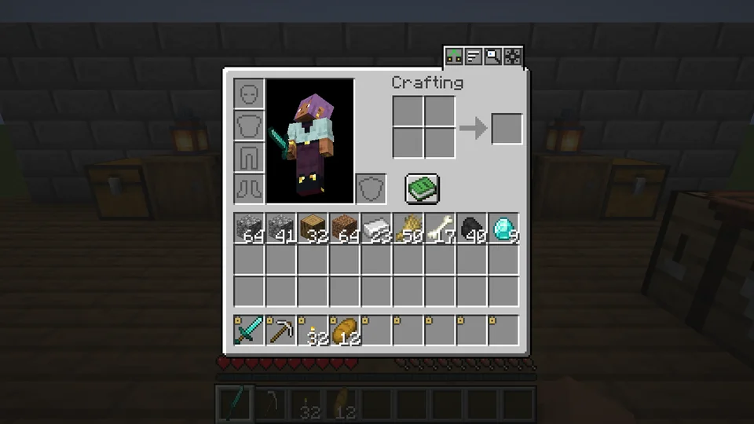
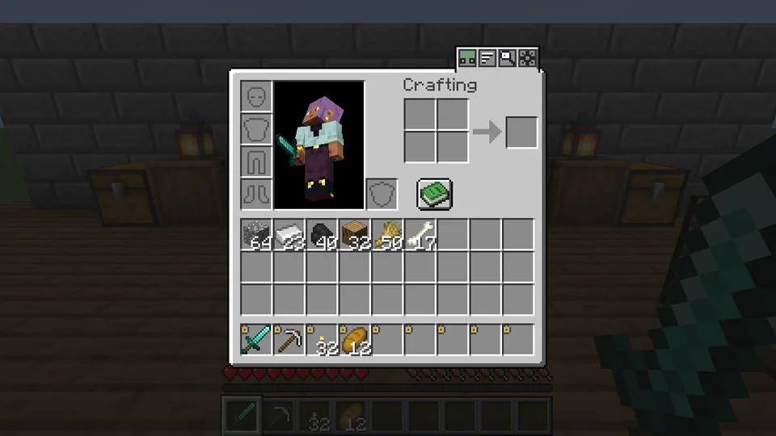
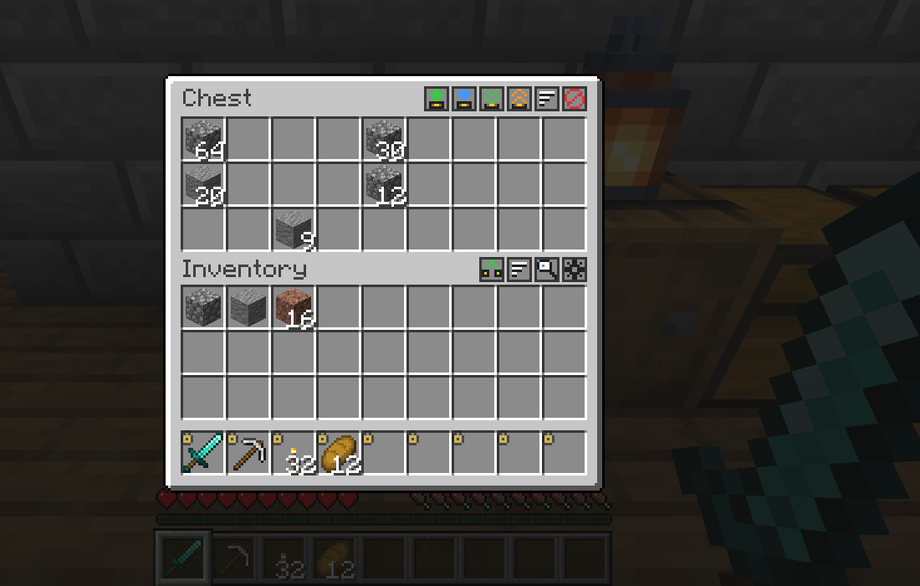
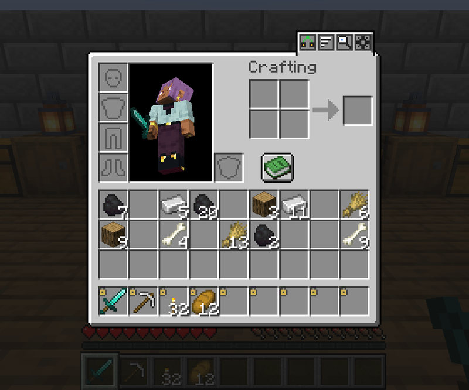
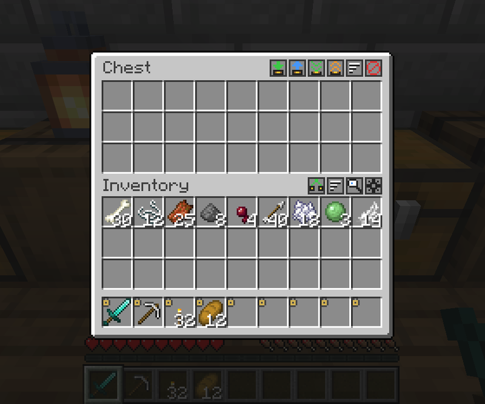
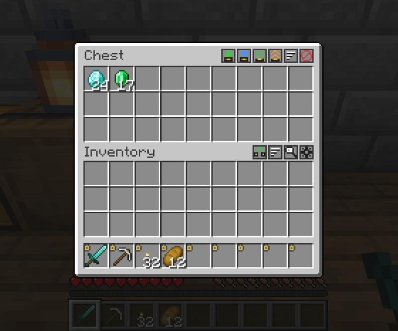
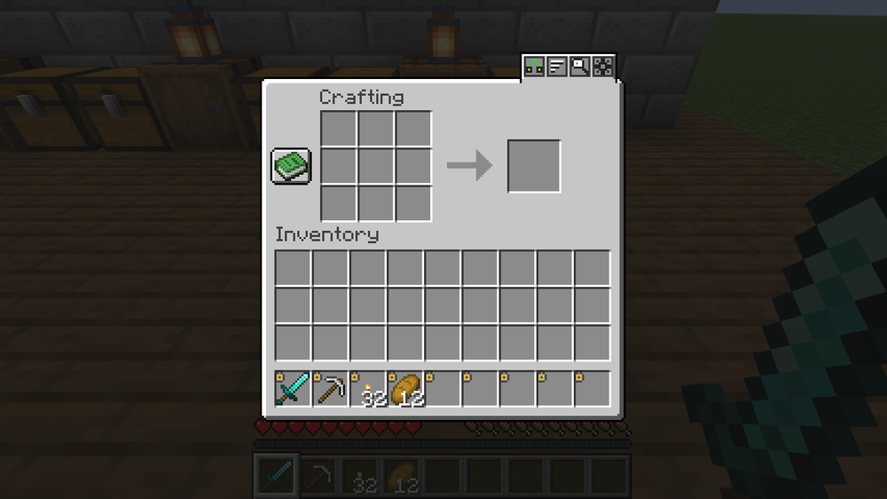
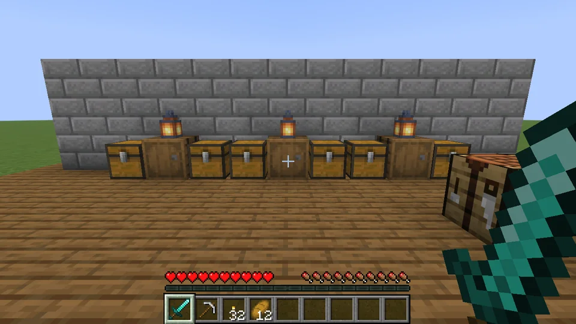

## QuickStack — Terraria-style inventory management

Press **Z** and watch your loot fly into the chests that already hold it. QuickStack brings Terraria's
*quick stack to nearby chests* to Minecraft, together with locked slots, sorting, crafting from nearby chests
and a handful of small tweaks that make chest rooms painless.

### ✨ Quick stack to nearby chests
Press **Z** (or the button in your inventory). The inventory closes, your items burst out in front of you and
fly one by one into the nearby chests, barrels and shulker boxes that already contain the same item. Chests open
their lids as the items land.

### 🔒 Locked slots
**Alt + click** a slot to lock it. Locked slots never leave: not by quick stack, not by "deposit all", not by
sorting. The hotbar is locked by default; armour and offhand are never touched.

### 📦 Chest buttons
Every chest, barrel and shulker box gets a row of small buttons:
- **Quick stack into this chest** — only items it already holds
- **Restock** — take the items you carry from the chest, leaving 1 of each behind (configurable)
- **Deposit all** / **Loot all**
- **Sort** the chest
- **Exclude** this chest from quick stack to nearby

### 🧹 Sorting
Sort your inventory or any chest with a button, a key or a **middle click**. By category, name or count.
Partial stacks are merged.

### 🖱️ Shift sweep
Hold **Shift + left mouse button** and sweep over slots: every slot you pass is shift-clicked into the other
inventory. Locked slots are skipped.

### 🎡 Mouse wheel, one item at a time
**Wheel up** over a stack picks up one more item, **wheel down** puts one back — like right clicks, but fast.

### 🛠️ Crafting from nearby chests
The recipe book counts the items in chests around you and the crafting grid takes missing ingredients straight
from them. Leftovers go back to the chest they came from when you close the table.

### 🔍 Find items
**F6** opens a grid of everything stored in the chests around you. Type to filter, click an item, and the chests
holding it light up with a column of sparkles you can see through walls.

### ↩️ Undo
Stacked the wrong thing? Bind the *Undo* key and take the last quick stack back.

---

### ⚙️ Settings
Everything can be changed in game: the gear button in the inventory, Mod Menu (Fabric) or the Mods list
(NeoForge). In singleplayer the second tab sets the world limits: radius, landing speed, crafting from nearby,
modded chests.

### 🚀 Performance
All transfers are done by the server in small batches per tick, and the flying items are client-side visuals
only, so nothing can be lost or duplicated. Tested with **2 352 full chests** within a 16-block radius: planning
takes about 7 ms and no server tick exceeded 5 ms while 36 stacks landed.

### 📋 Requirements
- Minecraft **26.3**
- **Fabric** (with Fabric API) or **NeoForge**
- Install on **both client and server** (singleplayer works out of the box)
- Optional: Mod Menu

Modded chests that work like vanilla containers (18+ slots) are supported automatically.

### 🌍 Languages
English, Українська, Deutsch, Français, Español, Português (Brasil), Italiano, Polski, Čeština, Türkçe,
Nederlands, 日本語, 한국어, 简体中文, 繁體中文, Қазақша, Oʻzbekcha, Кыргызча, Azərbaycanca, Հայերեն, ქართული,
Lietuvių, Latviešu, Eesti, Română, Монгол.

Source code, issues and translations: [https://github.com/ifoxp/QuickStack-Minecraft](https://github.com/ifoxp/QuickStack-Minecraft)

---

## 🌍 Other languages

Українська · Deutsch · Français · Español · Português (Brasil) · Italiano · Polski · Čeština · Türkçe · Nederlands · 日本語 · 한국어 · 简体中文 · 繁體中文 · Қазақша · Oʻzbekcha · Кыргызча · Azərbaycanca · Հայերեն · ქართული · Lietuvių · Latviešu · Eesti · Română · Монгол

---

### Українська

Натисни **Z** — і здобич сама полетить у скрині, де вже лежать такі самі предмети. QuickStack переносить у Minecraft
террарієвське *складання в найближчі скрині*, а разом із ним — зафіксовані слоти, сортування, крафт зі скринь поруч
і купу дрібних покращень, з якими скриньковий склад більше не болить.

#### ✨ Складання в найближчі скрині
Натисни **Z** (або кнопку в інвентарі). Інвентар закриється, предмети вилетять перед тобою і один за одним
полетять у найближчі скрині, бочки та шалкерові скрині, де вже є такий самий предмет. Скрині відкривають кришки,
коли предмети приземляються.

#### 🔒 Зафіксовані слоти
**Alt + клік** по слоту фіксує його. Зафіксовані слоти нікуди не дінуться: ні при складанні, ні при «Покласти все»,
ні при сортуванні. Панель швидкого доступу зафіксована за замовчуванням; броню та другу руку мод не чіпає взагалі.

#### 📦 Кнопки скрині
Кожна скриня, бочка й шалкерова скриня отримує ряд маленьких кнопок:
- **Скласти в цю скриню** — лише те, що в ній уже є
- **Поповнити** — забрати зі скрині те, що ти вже носиш, лишивши по 1 штуці кожного (налаштовується)
- **Покласти все** / **Забрати все**
- **Сортувати** скриню
- **Виключити** цю скриню зі складання в найближчі

#### 🧹 Сортування
Сортуй інвентар або будь-яку скриню кнопкою, клавішею чи **кліком середньої кнопки**. За категорією, назвою або
кількістю. Неповні стаки об'єднуються.

#### 🖱️ Shift-протягування
Затисни **Shift + ліву кнопку миші** і проведи по слотах: кожен слот, над яким пройде курсор, переноситься в інший
інвентар, як від Shift-кліку. Зафіксовані слоти пропускаються.

#### 🎡 Колесико миші — по одному предмету
**Колесико вгору** над стаком бере ще один предмет, **колесико вниз** кладе один назад — як правий клік, тільки
швидше.

#### 🛠️ Крафт зі скринь поруч
Книга рецептів враховує предмети в скринях навколо, а сітка крафту бере відсутні інгредієнти просто з них. Залишки
повертаються в ту скриню, звідки прийшли, коли ти закриваєш верстак.

#### 🔍 Пошук предметів
**F6** відкриває сітку з усім, що лежить у скринях навколо. Друкуй, щоб відфільтрувати, клікни на предмет — і скрині,
де він є, засвітяться стовпом іскор, видимим крізь стіни.

#### ↩️ Скасування
Склав не те? Признач клавішу *Скасувати* і поверни останнє складання.

---

#### ⚙️ Налаштування
Усе змінюється прямо в грі: кнопка-шестерня в інвентарі, Mod Menu (Fabric) або список модів (NeoForge). В одиночній
грі друга вкладка задає обмеження світу: радіус, швидкість приземлення, крафт зі скринь поруч, модові скрині.

#### 🚀 Продуктивність
Усі переміщення виконує сервер невеликими порціями за тік, а летючі предмети — лише візуальний ефект на клієнті,
тож нічого не може загубитися чи здублюватися. Перевірено на **2 352 повних скринях** у радіусі 16 блоків:
планування займає близько 7 мс, і жоден серверний тік не перевищив 5 мс, поки приземлялися 36 стаків.

#### 📋 Вимоги
- Minecraft **26.3**
- **Fabric** (з Fabric API) або **NeoForge**
- Встановлювати **і на клієнт, і на сервер** (в одиночній грі все працює одразу)
- Необов'язково: Mod Menu

Модові скрині, що працюють як ванільні контейнери (18+ слотів), підтримуються автоматично.

---

### Deutsch

Drück **Z** und sieh zu, wie deine Beute in die Truhen fliegt, die sie schon enthalten. QuickStack bringt Terrarias
*Schnellablage in Truhen in der Nähe* nach Minecraft – dazu gesperrte Plätze, Sortieren, Herstellen aus Truhen in
der Nähe und eine Handvoll kleiner Verbesserungen, die Lagerräume endlich angenehm machen.

#### ✨ In Truhen in der Nähe ablegen
Drück **Z** (oder den Knopf im Inventar). Das Inventar schließt sich, deine Gegenstände springen vor dir heraus und
fliegen einzeln in die Truhen, Fässer und Shulker-Kisten in der Nähe, die bereits denselben Gegenstand enthalten.
Die Truhen öffnen ihre Deckel, wenn die Gegenstände landen.

#### 🔒 Gesperrte Plätze
**Alt + Klick** auf einen Platz sperrt ihn. Gesperrte Plätze bleiben immer: nicht beim Ablegen, nicht bei
„Alles ablegen“, nicht beim Sortieren. Die Schnellzugriffsleiste ist standardmäßig gesperrt; Rüstung und
Zweithand werden nie angefasst.

#### 📦 Truhen-Knöpfe
Jede Truhe, jedes Fass und jede Shulker-Kiste bekommt eine Reihe kleiner Knöpfe:
- **In diese Truhe ablegen** – nur Gegenstände, die sie schon enthält
- **Auffüllen** – nimm dir aus der Truhe, was du schon trägst, und lass von jedem 1 zurück (einstellbar)
- **Alles ablegen** / **Alles nehmen**
- Die Truhe **sortieren**
- Diese Truhe vom Ablegen in der Nähe **ausschließen**

#### 🧹 Sortieren
Sortiere dein Inventar oder jede Truhe per Knopf, Taste oder **Mittelklick**. Nach Kategorie, Name oder Anzahl.
Angebrochene Stapel werden zusammengelegt.

#### 🖱️ Shift-Wischen
Halte **Shift + linke Maustaste** und fahre über die Plätze: Jeder Platz, über den du fährst, wird per Shift-Klick
ins andere Inventar verschoben. Gesperrte Plätze werden übersprungen.

#### 🎡 Mausrad, ein Gegenstand nach dem anderen
**Mausrad hoch** über einem Stapel nimmt einen Gegenstand mehr auf, **Mausrad runter** legt einen zurück – wie
Rechtsklicks, nur schneller.

#### 🛠️ Herstellen aus Truhen in der Nähe
Das Rezeptbuch zählt die Gegenstände in den Truhen um dich herum mit, und das Handwerksraster nimmt fehlende Zutaten
direkt aus ihnen. Reste wandern beim Schließen der Werkbank zurück in die Truhe, aus der sie kamen.

#### 🔍 Gegenstände finden
**F6** öffnet ein Raster mit allem, was in den Truhen um dich herum lagert. Tippe zum Filtern, klicke einen
Gegenstand an, und die Truhen, die ihn enthalten, leuchten mit einer Funkensäule auf, die du durch Wände siehst.

#### ↩️ Rückgängig
Das Falsche abgelegt? Belege die Taste *Rückgängig* und hol dir die letzte Ablage zurück.

---

#### ⚙️ Einstellungen
Alles lässt sich im Spiel ändern: über den Zahnrad-Knopf im Inventar, Mod Menu (Fabric) oder die Mod-Liste
(NeoForge). Im Einzelspieler legt der zweite Reiter die Grenzen der Welt fest: Radius, Landegeschwindigkeit,
Herstellen aus Truhen in der Nähe, Mod-Truhen.

#### 🚀 Leistung
Alle Übertragungen erledigt der Server in kleinen Portionen pro Tick, und die fliegenden Gegenstände sind nur
clientseitige Effekte – es kann also nichts verloren gehen oder dupliziert werden. Getestet mit **2 352 vollen
Truhen** im Umkreis von 16 Blöcken: Die Planung dauert etwa 7 ms, und kein Server-Tick überschritt 5 ms, während
36 Stapel landeten.

#### 📋 Voraussetzungen
- Minecraft **26.3**
- **Fabric** (mit Fabric API) oder **NeoForge**
- Auf **Client und Server** installieren (im Einzelspieler funktioniert es sofort)
- Optional: Mod Menu

Mod-Truhen, die wie Vanilla-Behälter funktionieren (18+ Plätze), werden automatisch unterstützt.

---

### Français

Appuyez sur **Z** et regardez votre butin s'envoler vers les coffres qui en contiennent déjà. QuickStack apporte à
Minecraft le *rangement rapide dans les coffres proches* de Terraria, avec des emplacements verrouillés, le tri, la
fabrication depuis les coffres proches et une poignée de petites améliorations qui rendent les salles de stockage
indolores.

#### ✨ Rangement rapide dans les coffres proches
Appuyez sur **Z** (ou sur le bouton de l'inventaire). L'inventaire se ferme, vos objets jaillissent devant vous et
volent un par un vers les coffres, tonneaux et boîtes de Shulker proches qui contiennent déjà le même objet. Les
coffres ouvrent leur couvercle quand les objets y atterrissent.

#### 🔒 Emplacements verrouillés
**Alt + clic** sur un emplacement pour le verrouiller. Les emplacements verrouillés ne bougent jamais : ni avec le
rangement rapide, ni avec « Tout déposer », ni avec le tri. La barre d'action est verrouillée par défaut ; l'armure
et la seconde main ne sont jamais touchées.

#### 📦 Boutons des coffres
Chaque coffre, tonneau et boîte de Shulker reçoit une rangée de petits boutons :
- **Ranger dans ce coffre** — seulement les objets qu'il contient déjà
- **Se réapprovisionner** — reprendre au coffre les objets que vous portez, en y laissant 1 de chaque (réglable)
- **Tout déposer** / **Tout prendre**
- **Trier** le coffre
- **Exclure** ce coffre du rangement dans les coffres proches

#### 🧹 Tri
Triez votre inventaire ou n'importe quel coffre avec un bouton, une touche ou un **clic molette**. Par catégorie,
nom ou quantité. Les piles incomplètes sont fusionnées.

#### 🖱️ Balayage Shift
Maintenez **Shift + clic gauche** et balayez les emplacements : chaque emplacement survolé est transféré dans l'autre
inventaire comme avec un Shift-clic. Les emplacements verrouillés sont ignorés.

#### 🎡 Molette de la souris, un objet à la fois
**Molette vers le haut** sur une pile prend un objet de plus, **molette vers le bas** en repose un — comme des clics
droits, mais en plus rapide.

#### 🛠️ Fabrication depuis les coffres proches
Le livre de recettes compte les objets des coffres autour de vous, et la grille de fabrication y prend directement
les ingrédients manquants. Les restes retournent dans leur coffre d'origine quand vous fermez l'établi.

#### 🔍 Trouver des objets
**F6** ouvre une grille de tout ce qui est stocké dans les coffres autour de vous. Tapez pour filtrer, cliquez sur un
objet, et les coffres qui le contiennent s'illuminent d'une colonne d'étincelles visible à travers les murs.

#### ↩️ Annuler
Vous avez rangé la mauvaise chose ? Assignez la touche *Annuler* et récupérez le dernier rangement.

---

#### ⚙️ Options
Tout se règle en jeu : le bouton en forme d'engrenage dans l'inventaire, Mod Menu (Fabric) ou la liste des mods
(NeoForge). En solo, le second onglet fixe les limites du monde : rayon, vitesse d'atterrissage, fabrication depuis
les coffres proches, coffres moddés.

#### 🚀 Performances
Tous les transferts sont faits par le serveur en petits lots à chaque tick, et les objets volants ne sont qu'un effet
visuel côté client : rien ne peut être perdu ni dupliqué. Testé avec **2 352 coffres pleins** dans un rayon de
16 blocs : la planification prend environ 7 ms et aucun tick serveur n'a dépassé 5 ms pendant l'atterrissage de
36 piles.

#### 📋 Prérequis
- Minecraft **26.3**
- **Fabric** (avec Fabric API) ou **NeoForge**
- À installer **sur le client et sur le serveur** (en solo, tout fonctionne directement)
- Optionnel : Mod Menu

Les coffres moddés qui fonctionnent comme les conteneurs vanilla (18+ emplacements) sont pris en charge automatiquement.

---

### Español

Pulsa **Z** y mira cómo tu botín vuela a los cofres que ya lo contienen. QuickStack trae a Minecraft el *depósito
rápido en cofres cercanos* de Terraria, junto con espacios bloqueados, ordenación, fabricación desde cofres cercanos
y un puñado de pequeñas mejoras que hacen que los almacenes dejen de ser un dolor de cabeza.

#### ✨ Depósito rápido en cofres cercanos
Pulsa **Z** (o el botón del inventario). El inventario se cierra, tus objetos salen disparados delante de ti y vuelan
uno a uno a los cofres, barriles y cajas de shulker cercanos que ya contienen ese mismo objeto. Los cofres abren la
tapa cuando los objetos aterrizan.

#### 🔒 Espacios bloqueados
**Alt + clic** en un espacio para bloquearlo. Los espacios bloqueados nunca se vacían: ni con el depósito rápido, ni
con «Depositar todo», ni al ordenar. La barra de acceso rápido está bloqueada por defecto; la armadura y la mano
secundaria nunca se tocan.

#### 📦 Botones del cofre
Cada cofre, barril y caja de shulker recibe una fila de pequeños botones:
- **Depositar en este cofre** — solo los objetos que ya contiene
- **Reabastecerse** — saca del cofre los objetos que ya llevas, dejando 1 de cada uno (configurable)
- **Depositar todo** / **Sacar todo**
- **Ordenar** el cofre
- **Excluir** este cofre del depósito en cofres cercanos

#### 🧹 Ordenar
Ordena tu inventario o cualquier cofre con un botón, una tecla o un **clic central**. Por categoría, nombre o
cantidad. Las pilas incompletas se juntan.

#### 🖱️ Barrido con Shift
Mantén **Shift + botón izquierdo del ratón** y pasa por encima de los espacios: cada espacio por el que pases se
mueve al otro inventario como con Shift + clic. Los espacios bloqueados se saltan.

#### 🎡 Rueda del ratón, objeto a objeto
**Rueda hacia arriba** sobre una pila coge un objeto más, **rueda hacia abajo** devuelve uno: como los clics
derechos, pero más rápido.

#### 🛠️ Fabricar desde cofres cercanos
El libro de recetas cuenta los objetos de los cofres que te rodean y la cuadrícula de fabricación toma de ellos los
ingredientes que falten. Lo que sobra vuelve al cofre de donde salió cuando cierras la mesa de trabajo.

#### 🔍 Buscar objetos
**F6** abre una cuadrícula con todo lo que hay guardado en los cofres de tu alrededor. Escribe para filtrar, haz clic
en un objeto y los cofres que lo contienen se iluminan con una columna de destellos que se ve a través de las paredes.

#### ↩️ Deshacer
¿Has guardado lo que no era? Asigna la tecla *Deshacer* y recupera el último depósito.

---

#### ⚙️ Opciones
Todo se puede cambiar en el juego: con el botón del engranaje del inventario, Mod Menu (Fabric) o la lista de mods
(NeoForge). En un jugador, la segunda pestaña fija los límites del mundo: radio, velocidad de aterrizaje,
fabricación desde cofres cercanos y cofres de mods.

#### 🚀 Rendimiento
Todas las transferencias las hace el servidor en pequeños lotes por tick, y los objetos voladores son solo un efecto
visual del cliente, así que nada puede perderse ni duplicarse. Probado con **2 352 cofres llenos** en un radio de
16 bloques: la planificación tarda unos 7 ms y ningún tick del servidor superó los 5 ms mientras aterrizaban
36 pilas.

#### 📋 Requisitos
- Minecraft **26.3**
- **Fabric** (con Fabric API) o **NeoForge**
- Instalar **en el cliente y en el servidor** (en un jugador funciona sin más)
- Opcional: Mod Menu

Los cofres de mods que funcionan como contenedores vanilla (18+ espacios) son compatibles automáticamente.

---

### Português (Brasil)

Aperte **Z** e veja seu saque voar para os baús que já têm aqueles itens. O QuickStack traz para o Minecraft o
*guardar rápido em baús próximos* do Terraria, junto com espaços travados, organização, fabricação a partir de baús
próximos e um punhado de pequenas melhorias que deixam o depósito de baús sem dor de cabeça.

#### ✨ Guardar rápido em baús próximos
Aperte **Z** (ou o botão no inventário). O inventário fecha, seus itens saltam na sua frente e voam um por um para os
baús, barris e caixas de Shulker próximos que já contêm o mesmo item. Os baús abrem a tampa quando os itens chegam.

#### 🔒 Espaços travados
**Alt + clique** em um espaço para travá-lo. Espaços travados nunca saem do lugar: nem no guardar rápido, nem no
"Guardar tudo", nem na organização. A barra de acesso rápido vem travada por padrão; armadura e mão secundária nunca
são mexidas.

#### 📦 Botões do baú
Todo baú, barril e caixa de Shulker ganha uma fileira de botõezinhos:
- **Guardar neste baú** — só os itens que ele já tem
- **Reabastecer** — pegue do baú os itens que você carrega, deixando 1 de cada (configurável)
- **Guardar tudo** / **Pegar tudo**
- **Organizar** o baú
- **Excluir** este baú do guardar em baús próximos

#### 🧹 Organização
Organize seu inventário ou qualquer baú com um botão, uma tecla ou um **clique do meio**. Por categoria, nome ou
quantidade. Pilhas incompletas são juntadas.

#### 🖱️ Arrastar com Shift
Segure **Shift + botão esquerdo do mouse** e passe por cima dos espaços: cada espaço por onde você passar vai para o
outro inventário, como num Shift + clique. Espaços travados são pulados.

#### 🎡 Roda do mouse, um item por vez
**Roda para cima** sobre uma pilha pega mais um item, **roda para baixo** devolve um — como cliques direitos, só que
rápido.

#### 🛠️ Fabricação a partir de baús próximos
O livro de receitas conta os itens dos baús ao seu redor e a grade de fabricação pega deles os ingredientes que
faltam. As sobras voltam para o baú de onde vieram quando você fecha a bancada de trabalho.

#### 🔍 Encontrar itens
**F6** abre uma grade com tudo o que está guardado nos baús ao seu redor. Digite para filtrar, clique num item e os
baús que o contêm se acendem com uma coluna de brilhos que dá para ver através das paredes.

#### ↩️ Desfazer
Guardou a coisa errada? Defina a tecla *Desfazer* e traga de volta o último depósito.

---

#### ⚙️ Opções
Tudo pode ser alterado no jogo: pelo botão de engrenagem no inventário, pelo Mod Menu (Fabric) ou pela lista de mods
(NeoForge). No modo um jogador, a segunda aba define os limites do mundo: raio, velocidade de chegada, fabricação a
partir de baús próximos e baús de mods.

#### 🚀 Desempenho
Todas as transferências são feitas pelo servidor em pequenos lotes por tick, e os itens voando são só efeito visual
no cliente, então nada pode ser perdido ou duplicado. Testado com **2 352 baús cheios** num raio de 16 blocos: o
planejamento leva cerca de 7 ms e nenhum tick do servidor passou de 5 ms enquanto 36 pilhas chegavam.

#### 📋 Requisitos
- Minecraft **26.3**
- **Fabric** (com Fabric API) ou **NeoForge**
- Instale **no cliente e no servidor** (no modo um jogador funciona direto)
- Opcional: Mod Menu

Baús de mods que funcionam como contêineres vanilla (18+ espaços) são suportados automaticamente.

---

### Italiano

Premi **Z** e guarda il tuo bottino volare nei bauli che lo contengono già. QuickStack porta in Minecraft il
*deposito rapido nei bauli vicini* di Terraria, insieme a slot bloccati, ordinamento, fabbricazione dai bauli vicini e
una manciata di piccole migliorie che rendono indolori le stanze dei bauli.

#### ✨ Deposito rapido nei bauli vicini
Premi **Z** (o il pulsante nell'inventario). L'inventario si chiude, i tuoi oggetti schizzano fuori davanti a te e
volano uno alla volta nei bauli, barili e scatole di shulker vicini che contengono già lo stesso oggetto. I bauli
aprono il coperchio quando gli oggetti atterrano.

#### 🔒 Slot bloccati
**Alt + clic** su uno slot per bloccarlo. Gli slot bloccati non si svuotano mai: né col deposito rapido, né con
"Deposita tutto", né con l'ordinamento. La barra rapida è bloccata di default; armatura e mano secondaria non vengono
mai toccate.

#### 📦 Pulsanti dei bauli
Ogni baule, barile e scatola di shulker riceve una fila di piccoli pulsanti:
- **Deposita in questo baule** — solo gli oggetti che contiene già
- **Rifornisciti** — prendi dal baule gli oggetti che hai con te, lasciandone 1 per tipo (configurabile)
- **Deposita tutto** / **Prendi tutto**
- **Ordina** il baule
- **Escludi** questo baule dal deposito nei bauli vicini

#### 🧹 Ordinamento
Ordina l'inventario o qualsiasi baule con un pulsante, un tasto o un **clic centrale**. Per categoria, nome o
quantità. Le pile incomplete vengono unite.

#### 🖱️ Trascina con Shift
Tieni premuti **Shift + tasto sinistro del mouse** e passa sopra gli slot: ogni slot su cui passi viene spostato
nell'altro inventario come con Shift + clic. Gli slot bloccati vengono saltati.

#### 🎡 Rotella del mouse, un oggetto alla volta
**Rotella su** sopra una pila prende un oggetto in più, **rotella giù** ne rimette uno — come i clic destri, ma più
veloce.

#### 🛠️ Fabbricazione dai bauli vicini
Il ricettario conta gli oggetti nei bauli intorno a te e la griglia di fabbricazione prende da lì gli ingredienti
mancanti. Gli avanzi tornano nel baule da cui provenivano quando chiudi il banco da lavoro.

#### 🔍 Trova oggetti
**F6** apre una griglia con tutto ciò che è conservato nei bauli intorno a te. Scrivi per filtrare, clicca su un
oggetto e i bauli che lo contengono si illuminano con una colonna di scintille visibile attraverso i muri.

#### ↩️ Annulla
Hai depositato la cosa sbagliata? Assegna il tasto *Annulla* e riprenditi l'ultimo deposito.

---

#### ⚙️ Impostazioni
Tutto si può cambiare in gioco: dal pulsante a ingranaggio nell'inventario, da Mod Menu (Fabric) o dall'elenco delle
mod (NeoForge). In giocatore singolo, la seconda scheda imposta i limiti del mondo: raggio, velocità di atterraggio,
fabbricazione dai bauli vicini, bauli delle mod.

#### 🚀 Prestazioni
Tutti i trasferimenti li esegue il server a piccoli lotti per tick, e gli oggetti in volo sono solo un effetto
grafico lato client: niente può andare perso o duplicarsi. Testato con **2 352 bauli pieni** in un raggio di
16 blocchi: la pianificazione richiede circa 7 ms e nessun tick del server ha superato i 5 ms mentre atterravano
36 pile.

#### 📋 Requisiti
- Minecraft **26.3**
- **Fabric** (con Fabric API) o **NeoForge**
- Da installare **sia sul client sia sul server** (in giocatore singolo funziona subito)
- Facoltativo: Mod Menu

I bauli delle mod che funzionano come i contenitori vanilla (18+ slot) sono supportati automaticamente.

---

### Polski

Wciśnij **Z** i patrz, jak łupy same lecą do skrzyń, w których już takie leżą. QuickStack przenosi do Minecrafta
znane z Terrarii *szybkie odkładanie do pobliskich skrzyń*, a razem z nim zablokowane sloty, sortowanie,
wytwarzanie z pobliskich skrzyń i garść drobnych usprawnień, dzięki którym magazyn przestaje być udręką.

#### ✨ Szybkie odkładanie do pobliskich skrzyń
Wciśnij **Z** (albo przycisk w ekwipunku). Ekwipunek się zamyka, przedmioty wyskakują przed tobą i jeden po drugim
lecą do pobliskich skrzyń, beczek i skrzyń shulkerowych, które już zawierają ten sam przedmiot. Skrzynie unoszą
wieka, gdy przedmioty do nich trafiają.

#### 🔒 Zablokowane sloty
**Alt + klik** na slot blokuje go. Zablokowane sloty nigdy się nie opróżniają: ani przy szybkim odkładaniu, ani przy
„Włóż wszystko”, ani przy sortowaniu. Pasek szybkiego dostępu jest domyślnie zablokowany; zbroi i drugiej ręki mod
w ogóle nie rusza.

#### 📦 Przyciski skrzyni
Każda skrzynia, beczka i skrzynia shulkerowa dostaje rząd małych przycisków:
- **Odłóż do tej skrzyni** — tylko przedmioty, które już w niej są
- **Uzupełnij** — weź ze skrzyni przedmioty, które nosisz, zostawiając po 1 z każdego (do ustawienia)
- **Włóż wszystko** / **Zabierz wszystko**
- **Sortuj** skrzynię
- **Wyklucz** tę skrzynię z odkładania do pobliskich

#### 🧹 Sortowanie
Sortuj ekwipunek lub dowolną skrzynię przyciskiem, klawiszem albo **środkowym przyciskiem myszy**. Według kategorii,
nazwy lub ilości. Niepełne stosy są łączone.

#### 🖱️ Przeciąganie z Shift
Przytrzymaj **Shift + lewy przycisk myszy** i przeciągnij po slotach: każdy slot, nad którym przejedziesz, trafia do
drugiego ekwipunku jak po Shift + kliknięciu. Zablokowane sloty są pomijane.

#### 🎡 Kółko myszy, po jednym przedmiocie
**Kółko w górę** nad stosem bierze jeszcze jeden przedmiot, **kółko w dół** odkłada jeden z powrotem — jak kliknięcia
prawym przyciskiem, tylko szybciej.

#### 🛠️ Wytwarzanie z pobliskich skrzyń
Książka receptur liczy przedmioty w skrzyniach wokół ciebie, a siatka wytwarzania bierze z nich brakujące składniki.
Resztki wracają do skrzyni, z której przyszły, gdy zamkniesz stół rzemieślniczy.

#### 🔍 Szukanie przedmiotów
**F6** otwiera siatkę ze wszystkim, co leży w skrzyniach wokół ciebie. Pisz, aby filtrować, kliknij przedmiot,
a skrzynie, które go zawierają, rozbłysną kolumną iskier widoczną przez ściany.

#### ↩️ Cofnij
Odłożyłeś nie to, co trzeba? Przypisz klawisz *Cofnij* i odzyskaj ostatnie odłożenie.

---

#### ⚙️ Ustawienia
Wszystko zmienisz w grze: przyciskiem z zębatką w ekwipunku, w Mod Menu (Fabric) lub na liście modów (NeoForge).
W grze jednoosobowej druga karta ustala limity świata: zasięg, prędkość lądowania, wytwarzanie z pobliskich skrzyń,
skrzynie z modów.

#### 🚀 Wydajność
Wszystkie przenosiny wykonuje serwer małymi porcjami na tick, a latające przedmioty to tylko efekt wizualny po
stronie klienta, więc nic nie może zginąć ani się zduplikować. Przetestowano na **2 352 pełnych skrzyniach**
w promieniu 16 bloków: planowanie trwa około 7 ms, a żaden tick serwera nie przekroczył 5 ms podczas lądowania
36 stosów.

#### 📋 Wymagania
- Minecraft **26.3**
- **Fabric** (z Fabric API) lub **NeoForge**
- Instalacja **na kliencie i na serwerze** (w grze jednoosobowej działa od razu)
- Opcjonalnie: Mod Menu

Skrzynie z modów działające jak zwykłe pojemniki (18+ slotów) są obsługiwane automatycznie.

---

### Čeština

Stiskni **Z** a sleduj, jak tvoje kořist letí do truhel, které ji už obsahují. QuickStack přináší do Minecraftu
*rychlé ukládání do truhel poblíž* z Terrarie a k tomu zamčené sloty, řazení, výrobu z truhel poblíž a hrst drobných
vylepšení, se kterými přestanou skladiště bolet.

#### ✨ Rychlé ukládání do truhel poblíž
Stiskni **Z** (nebo tlačítko v inventáři). Inventář se zavře, předměty vyletí před tebe a jeden po druhém letí do
truhel, sudů a shulkerových krabic poblíž, které už stejný předmět obsahují. Truhly při dopadu předmětů otevírají
víka.

#### 🔒 Zamčené sloty
**Alt + kliknutím** na slot ho zamkneš. Zamčené sloty se nikdy nevyprázdní: ani při rychlém ukládání, ani při
„Uložit vše“, ani při řazení. Lišta rychlého přístupu je ve výchozím stavu zamčená; brnění a druhé ruky se mod nikdy
nedotkne.

#### 📦 Tlačítka truhel
Každá truhla, sud i shulkerová krabice dostane řadu malých tlačítek:
- **Uložit do této truhly** — jen předměty, které už obsahuje
- **Doplnit** — vezmi z truhly předměty, které neseš, a nech od každého 1 (nastavitelné)
- **Uložit vše** / **Vybrat vše**
- **Seřadit** truhlu
- **Vyřadit** tuto truhlu z ukládání do truhel poblíž

#### 🧹 Řazení
Seřaď inventář nebo jakoukoli truhlu tlačítkem, klávesou nebo **prostředním tlačítkem myši**. Podle kategorie,
názvu nebo počtu. Neúplné balíky se sloučí.

#### 🖱️ Tažení se Shiftem
Drž **Shift + levé tlačítko myši** a přejeď přes sloty: každý slot, přes který přejedeš, se přesune do druhého
inventáře jako při Shift + kliknutí. Zamčené sloty se přeskočí.

#### 🎡 Kolečko myši, po jednom předmětu
**Kolečko nahoru** nad balíkem vezme další předmět, **kolečko dolů** jeden vrátí — jako kliknutí pravým tlačítkem,
jen rychleji.

#### 🛠️ Výroba z truhel poblíž
Kniha receptů započítá předměty v truhlách kolem tebe a výrobní mřížka si z nich rovnou vezme chybějící suroviny.
Zbytky se po zavření pracovního stolu vrátí do truhly, odkud přišly.

#### 🔍 Hledání předmětů
**F6** otevře mřížku se vším, co je uloženo v truhlách kolem tebe. Piš pro filtrování, klikni na předmět a truhly,
které ho obsahují, se rozzáří sloupem jisker viditelným skrz zdi.

#### ↩️ Vrácení
Uložil jsi něco špatně? Nastav klávesu *Vrátit* a vezmi poslední ukládání zpět.

---

#### ⚙️ Nastavení
Vše se dá změnit ve hře: tlačítkem s ozubeným kolem v inventáři, přes Mod Menu (Fabric) nebo seznam módů (NeoForge).
Ve hře jednoho hráče druhá záložka nastavuje limity světa: dosah, rychlost dopadu, výrobu z truhel poblíž, truhly
z módů.

#### 🚀 Výkon
Všechny přesuny provádí server po malých dávkách za tick a létající předměty jsou jen vizuální efekt na straně
klienta, takže se nic nemůže ztratit ani zdvojit. Otestováno na **2 352 plných truhlách** v okruhu 16 bloků:
plánování trvá asi 7 ms a žádný tick serveru nepřekročil 5 ms, zatímco dopadalo 36 balíků.

#### 📋 Požadavky
- Minecraft **26.3**
- **Fabric** (s Fabric API) nebo **NeoForge**
- Nainstalovat **na klienta i na server** (ve hře jednoho hráče funguje hned)
- Volitelně: Mod Menu

Truhly z módů, které fungují jako vanilla úložiště (18+ slotů), jsou podporovány automaticky.

---

### Türkçe

**Z**'ye bas ve ganimetinin, onu zaten içeren sandıklara uçuşunu izle. QuickStack, Terraria'nın *yakındaki
sandıklara hızlı yerleştirme* özelliğini Minecraft'a getiriyor; yanında kilitli yuvalar, sıralama, yakındaki
sandıklardan üretim ve sandık odalarını dert olmaktan çıkaran bir avuç küçük iyileştirme de var.

#### ✨ Yakındaki sandıklara hızlı yerleştirme
**Z**'ye bas (ya da envanterdeki düğmeye tıkla). Envanter kapanır, eşyaların önüne fırlar ve aynı eşyayı zaten
içeren yakındaki sandıklara, varillere ve Shulker kutularına tek tek uçar. Eşyalar indikçe sandıkların kapakları
açılır.

#### 🔒 Kilitli yuvalar
Bir yuvayı kilitlemek için **Alt + tıkla**. Kilitli yuvalar asla boşalmaz: ne hızlı yerleştirmede, ne "Hepsini
koy"da, ne de sıralamada. Hızlı erişim çubuğu varsayılan olarak kilitlidir; zırha ve ikincil ele hiç dokunulmaz.

#### 📦 Sandık düğmeleri
Her sandık, varil ve Shulker kutusu bir sıra küçük düğme kazanır:
- **Bu sandığa yerleştir** — sadece içinde zaten olan eşyalar
- **İkmal yap** — üzerindeki eşyalardan sandıkta olanları al, her birinden 1 tane bırak (ayarlanabilir)
- **Hepsini koy** / **Hepsini al**
- Sandığı **sırala**
- Bu sandığı yakındaki sandıklara yerleştirmeden **hariç tut**

#### 🧹 Sıralama
Envanterini ya da herhangi bir sandığı bir düğmeyle, bir tuşla veya **orta tıkla** sırala. Kategoriye, ada ya da
miktara göre. Yarım yığınlar birleştirilir.

#### 🖱️ Shift ile sürükleme
**Shift + sol fare tuşunu** basılı tut ve yuvaların üzerinden geç: üzerinden geçtiğin her yuva, Shift + tıklama
gibi diğer envantere aktarılır. Kilitli yuvalar atlanır.

#### 🎡 Fare tekerleği, birer birer
Bir yığının üzerinde **tekerleği yukarı** çevirmek bir eşya daha alır, **aşağı** çevirmek birini geri koyar — sağ
tıklama gibi, ama çok daha hızlı.

#### 🛠️ Yakındaki sandıklardan üretim
Tarif kitabı etrafındaki sandıklardaki eşyaları da sayar ve üretim ızgarası eksik malzemeleri doğrudan onlardan
alır. Çalışma masasını kapattığında artanlar geldikleri sandığa geri döner.

#### 🔍 Eşya bulma
**F6**, etrafındaki sandıklarda saklanan her şeyi gösteren bir ızgara açar. Filtrelemek için yaz, bir eşyaya tıkla;
onu içeren sandıklar duvarların arkasından bile görünen bir kıvılcım sütunuyla parlar.

#### ↩️ Geri al
Yanlış şeyi mi yerleştirdin? *Geri al* tuşunu ata ve son hızlı yerleştirmeyi geri getir.

---

#### ⚙️ Ayarlar
Her şey oyun içinden değiştirilebilir: envanterdeki dişli düğmesi, Mod Menu (Fabric) ya da mod listesi (NeoForge).
Tek oyunculu modda ikinci sekme dünya sınırlarını belirler: yarıçap, iniş hızı, yakındaki sandıklardan üretim, mod
sandıkları.

#### 🚀 Performans
Tüm aktarımları sunucu tik başına küçük partiler halinde yapar; uçan eşyalar ise yalnızca istemci tarafındaki görsel
efektlerdir, bu yüzden hiçbir şey kaybolamaz ya da kopyalanamaz. 16 blok yarıçap içinde **2 352 dolu sandıkla** test
edildi: planlama yaklaşık 7 ms sürüyor ve 36 yığın inerken hiçbir sunucu tiki 5 ms'yi aşmadı.

#### 📋 Gereksinimler
- Minecraft **26.3**
- **Fabric** (Fabric API ile) ya da **NeoForge**
- **Hem istemciye hem sunucuya** kurulmalı (tek oyunculu modda doğrudan çalışır)
- İsteğe bağlı: Mod Menu

Vanilla kaplar gibi çalışan mod sandıkları (18+ yuva) otomatik olarak desteklenir.

---

### Nederlands

Druk op **Z** en kijk hoe je buit naar de kisten vliegt waar hij al in zit. QuickStack brengt Terraria's *snel
opbergen in kisten in de buurt* naar Minecraft, samen met vergrendelde vakken, sorteren, vervaardigen uit kisten in de
buurt en een handvol kleine verbeteringen die opslagruimtes pijnloos maken.

#### ✨ Snel opbergen in kisten in de buurt
Druk op **Z** (of op de knop in je inventaris). De inventaris sluit, je voorwerpen springen voor je naar buiten en
vliegen één voor één naar de kisten, tonnen en shulkerdozen in de buurt waar hetzelfde voorwerp al in zit. De kisten
openen hun deksel als de voorwerpen landen.

#### 🔒 Vergrendelde vakken
**Alt + klik** op een vak om het te vergrendelen. Vergrendelde vakken gaan nooit leeg: niet bij snel opbergen, niet
bij "Alles erin", niet bij sorteren. De hotbar is standaard vergrendeld; harnas en tweede hand worden nooit
aangeraakt.

#### 📦 Kistknoppen
Elke kist, ton en shulkerdoos krijgt een rij kleine knoppen:
- **Opbergen in deze kist** — alleen voorwerpen die er al in zitten
- **Aanvullen** — pak uit de kist de voorwerpen die je al bij je hebt en laat er van elk 1 achter (instelbaar)
- **Alles erin** / **Alles eruit**
- De kist **sorteren**
- Deze kist **uitsluiten** van snel opbergen in de buurt

#### 🧹 Sorteren
Sorteer je inventaris of elke kist met een knop, een toets of een **middelklik**. Op categorie, naam of aantal.
Onvolledige stapels worden samengevoegd.

#### 🖱️ Shift-vegen
Houd **Shift + linkermuisknop** ingedrukt en veeg over de vakken: elk vak waar je overheen gaat, wordt met een
Shift-klik naar de andere inventaris verplaatst. Vergrendelde vakken worden overgeslagen.

#### 🎡 Muiswiel, één voorwerp tegelijk
**Wiel omhoog** boven een stapel pakt nog een voorwerp op, **wiel omlaag** legt er een terug — net als rechtsklikken,
maar sneller.

#### 🛠️ Vervaardigen uit kisten in de buurt
Het receptenboek telt de voorwerpen in de kisten om je heen mee en het craftraster haalt ontbrekende ingrediënten
daar meteen uit. Restjes gaan terug naar de kist waar ze vandaan kwamen als je de werkbank sluit.

#### 🔍 Voorwerpen zoeken
**F6** opent een raster met alles wat in de kisten om je heen ligt. Typ om te filteren, klik op een voorwerp en de
kisten waar het in zit lichten op met een zuil van vonken die je door muren heen ziet.

#### ↩️ Ongedaan maken
Het verkeerde opgeborgen? Stel de toets *Ongedaan maken* in en haal de laatste opberging terug.

---

#### ⚙️ Instellingen
Alles is in het spel aan te passen: met de tandwielknop in de inventaris, Mod Menu (Fabric) of de lijst met mods
(NeoForge). In singleplayer stelt het tweede tabblad de grenzen van de wereld in: bereik, landingssnelheid, vervaardigen
uit kisten in de buurt, kisten uit mods.

#### 🚀 Prestaties
Alle overdrachten doet de server in kleine porties per tick, en de vliegende voorwerpen zijn alleen visuele effecten
op de client, dus er kan niets verloren gaan of gedupliceerd worden. Getest met **2 352 volle kisten** binnen een
straal van 16 blokken: plannen duurt ongeveer 7 ms en geen enkele servertick kwam boven 5 ms terwijl 36 stapels
landden.

#### 📋 Vereisten
- Minecraft **26.3**
- **Fabric** (met Fabric API) of **NeoForge**
- Installeren op **zowel client als server** (in singleplayer werkt het meteen)
- Optioneel: Mod Menu

Kisten uit mods die werken als vanilla-opslag (18+ vakken) worden automatisch ondersteund.

---

### 日本語

**Z** を押すだけで、手に入れたアイテムが同じアイテムの入ったチェストへ飛んでいきます。QuickStack は Terraria の
「近くのチェストにまとめて収納」を Minecraft に持ち込み、さらにスロットのロック、整理、近くのチェストからの
クラフト、そして倉庫部屋をぐっと快適にするちょっとした改善をまとめて追加します。

#### ✨ 近くのチェストにまとめて収納
**Z** を押します（またはインベントリのボタン）。インベントリが閉じ、アイテムが目の前に飛び出して、同じアイテムが
入っている近くのチェスト、樽、シュルカーボックスへ1つずつ飛んでいきます。アイテムが届くとチェストのふたが開きます。

#### 🔒 スロットのロック
スロットを **Alt + クリック** するとロックされます。ロックしたスロットは、まとめて収納でも「すべて入れる」でも
整理でも決して動きません。ホットバーは最初からロックされています。防具とオフハンドには一切触れません。

#### 📦 チェストのボタン
すべてのチェスト、樽、シュルカーボックスに小さなボタンが並びます：
- **このチェストに収納** — すでに入っているアイテムだけ
- **補充** — 持っているアイテムをチェストから取り出し、各1個を残す（設定可能）
- **すべて入れる** / **すべて取り出す**
- チェストを **整理**
- このチェストを近くへの収納から **除外**

#### 🧹 整理
インベントリやどのチェストも、ボタン、キー、または **中クリック** で整理できます。カテゴリー・名前・個数順に
並べ替え、半端なスタックはまとめられます。

#### 🖱️ Shiftスワイプ
**Shift + 左クリック** を押したままスロットをなぞると、通過したスロットがすべて Shift + クリックのように
もう一方のインベントリへ移動します。ロックしたスロットはスキップされます。

#### 🎡 マウスホイールで1個ずつ
スタックの上で **ホイールを上** に回すと1個多く取り、**下** に回すと1個戻します。右クリックと同じですが、ずっと
速くできます。

#### 🛠️ 近くのチェストからクラフト
レシピ本が周りのチェストのアイテムも数え、クラフトグリッドは足りない材料をそこから直接取ってきます。作業台を
閉じると、余った分は元のチェストに戻ります。

#### 🔍 アイテム検索
**F6** で周りのチェストにしまってあるすべてのアイテムの一覧が開きます。入力して絞り込み、アイテムをクリックすると、
それが入っているチェストが壁越しにも見える光の柱で光ります。

#### ↩️ 取り消し
間違えて収納しましたか？ *取り消し* キーを設定すれば、直前の収納を元に戻せます。

---

#### ⚙️ 設定
すべてゲーム内で変更できます：インベントリの歯車ボタン、Mod Menu（Fabric）、または Mod 一覧（NeoForge）から。
シングルプレイでは、2つ目のタブでワールドの制限を設定します：範囲、着地速度、近くのチェストからのクラフト、Mod の
チェスト。

#### 🚀 パフォーマンス
アイテムの移動はすべてサーバーが1 tick ごとに少しずつ行い、飛んでいくアイテムはクライアント側の演出にすぎないため、
アイテムが消えたり増えたりすることはありません。半径16ブロック以内の **2 352 個の満杯のチェスト** でテスト済み：
計画にかかる時間は約 7 ms、36 スタックが着地する間もサーバーの tick が 5 ms を超えることはありませんでした。

#### 📋 動作環境
- Minecraft **26.3**
- **Fabric**（Fabric API が必要）または **NeoForge**
- **クライアントとサーバーの両方** に導入（シングルプレイならそのまま動作）
- 任意：Mod Menu

バニラのコンテナと同じように動作する Mod のチェスト（18 スロット以上）には自動で対応します。

---

### 한국어

**Z**를 누르면 전리품이 같은 아이템이 든 상자로 날아갑니다. QuickStack은 테라리아의 *주변 상자에 빠르게 정리*
기능을 Minecraft로 가져오고, 슬롯 잠금, 정렬, 주변 상자로 제작, 그리고 창고 관리를 훨씬 편하게 해 주는 작은
개선들을 함께 제공합니다.

#### ✨ 주변 상자에 빠르게 정리
**Z**를 누르세요(또는 보관함의 버튼). 보관함이 닫히고, 아이템이 눈앞으로 튀어나와 같은 아이템이 이미 들어 있는
주변의 상자, 통, 셜커 상자로 하나씩 날아갑니다. 아이템이 들어갈 때 상자 뚜껑이 열립니다.

#### 🔒 슬롯 잠금
슬롯을 **Alt + 클릭**하면 잠깁니다. 잠긴 슬롯은 빠른 정리에서도, "모두 넣기"에서도, 정렬에서도 절대 움직이지
않습니다. 단축바는 기본적으로 잠겨 있으며, 갑옷과 보조 손은 절대 건드리지 않습니다.

#### 📦 상자 버튼
모든 상자, 통, 셜커 상자에 작은 버튼 줄이 생깁니다:
- **이 상자에 정리** — 이미 들어 있는 아이템만
- **보충** — 가지고 다니는 아이템을 상자에서 꺼내고, 종류별로 1개씩 남김(설정 가능)
- **모두 넣기** / **모두 꺼내기**
- 상자 **정렬**
- 이 상자를 주변 정리에서 **제외**

#### 🧹 정렬
보관함이나 어떤 상자든 버튼, 키 또는 **휠 클릭**으로 정렬하세요. 카테고리, 이름, 개수 기준으로 정렬하며, 덜 찬
묶음은 하나로 합쳐집니다.

#### 🖱️ Shift 쓸기
**Shift + 마우스 왼쪽 버튼**을 누른 채 슬롯 위를 쓸어 보세요. 지나간 모든 슬롯이 Shift + 클릭한 것처럼 다른
보관함으로 옮겨집니다. 잠긴 슬롯은 건너뜁니다.

#### 🎡 마우스 휠로 하나씩
묶음 위에서 **휠을 위로** 굴리면 하나를 더 집고, **아래로** 굴리면 하나를 되돌려 놓습니다. 우클릭과 같지만 훨씬
빠릅니다.

#### 🛠️ 주변 상자로 제작
제작법 책이 주변 상자의 아이템까지 세고, 제작 칸은 부족한 재료를 상자에서 바로 가져옵니다. 제작대를 닫으면 남은
재료는 원래 상자로 돌아갑니다.

#### 🔍 아이템 찾기
**F6**을 누르면 주변 상자에 보관된 모든 아이템이 격자로 표시됩니다. 입력해서 걸러 내고 아이템을 클릭하면, 그
아이템이 든 상자가 벽 너머로도 보이는 반짝이 기둥으로 빛납니다.

#### ↩️ 되돌리기
잘못 정리했나요? *되돌리기* 키를 지정하면 마지막 빠른 정리를 되돌릴 수 있습니다.

---

#### ⚙️ 설정
모든 설정은 게임 안에서 바꿀 수 있습니다: 보관함의 톱니바퀴 버튼, Mod Menu(Fabric) 또는 모드 목록(NeoForge).
싱글플레이에서는 두 번째 탭에서 세계의 제한을 정합니다: 반경, 도착 속도, 주변 상자로 제작, 모드 상자.

#### 🚀 성능
모든 이동은 서버가 틱마다 조금씩 처리하고, 날아가는 아이템은 클라이언트 쪽 연출일 뿐이라 아무것도 사라지거나
복제되지 않습니다. 반경 16블록 안의 **가득 찬 상자 2 352개**로 테스트했습니다: 계획에 약 7 ms가 걸리며,
36묶음이 도착하는 동안 서버 틱은 한 번도 5 ms를 넘지 않았습니다.

#### 📋 요구 사항
- Minecraft **26.3**
- **Fabric**(Fabric API 필요) 또는 **NeoForge**
- **클라이언트와 서버 모두**에 설치(싱글플레이에서는 바로 작동)
- 선택: Mod Menu

바닐라 보관 블록처럼 작동하는 모드 상자(18칸 이상)는 자동으로 지원됩니다.

---

### 简体中文

按下 **Z**，看着战利品飞进已经装有同类物品的箱子。QuickStack 把泰拉瑞亚的*快速堆叠到附近箱子*带进了
Minecraft，同时还有槽位锁定、整理、从附近箱子合成，以及一系列让仓库管理不再头疼的小改进。

#### ✨ 快速堆叠到附近箱子
按下 **Z**（或点击物品栏中的按钮）。物品栏关闭，物品从你面前喷出，一个接一个飞进附近已装有相同物品的箱子、木桶和
潜影盒。物品落入时，箱子会打开盖子。

#### 🔒 槽位锁定
**Alt + 点击**槽位即可锁定。锁定的槽位永远不会被清空：快速堆叠不会，"全部放入"不会，整理也不会。快捷栏默认锁定；
盔甲和副手永远不会被动到。

#### 📦 箱子按钮
每个箱子、木桶和潜影盒都会多出一排小按钮：
- **快速堆叠到此箱子** — 只放入箱中已有的物品
- **补货** — 从箱子取出你身上已有的物品，每种留下 1 个（可调）
- **全部放入** / **全部取出**
- **整理**箱子
- 将此箱子**排除**在附近快速堆叠之外

#### 🧹 整理
用按钮、按键或**鼠标中键**整理物品栏或任意箱子。可按类别、名称或数量排序，不满的物品堆会自动合并。

#### 🖱️ Shift 滑动
按住 **Shift + 鼠标左键**在槽位上划过：划过的每个槽位都会像 Shift + 点击一样移到另一边的物品栏。锁定的槽位会被跳过。

#### 🎡 鼠标滚轮，一次一个
在物品堆上**向上滚动**多拿一个，**向下滚动**放回一个——和右键一样，但快得多。

#### 🛠️ 从附近箱子合成
配方书会把周围箱子里的物品也算进去，合成格会直接从箱子里取用缺少的材料。关闭工作台时，剩下的材料会回到原来的箱子。

#### 🔍 查找物品
按 **F6** 打开一个网格，显示周围箱子里存放的所有物品。输入文字筛选，点击某个物品，装有它的箱子就会亮起一道能穿墙
看见的闪光光柱。

#### ↩️ 撤销
放错了东西？绑定*撤销*键，就能把上一次快速堆叠撤回来。

---

#### ⚙️ 设置
一切都能在游戏内修改：物品栏中的齿轮按钮、Mod Menu（Fabric）或模组列表（NeoForge）。在单人游戏中，第二个标签页
用于设置世界限制：半径、落入速度、从附近箱子合成、模组箱子。

#### 🚀 性能
所有转移都由服务器按每刻小批量完成，飞行的物品只是客户端的视觉效果，因此物品不会丢失也不会复制。在 16 格半径内的
**2 352 个装满的箱子**上测试：规划耗时约 7 ms，36 组物品落入期间没有任何一个服务器刻超过 5 ms。

#### 📋 需求
- Minecraft **26.3**
- **Fabric**（需要 Fabric API）或 **NeoForge**
- 需要**同时安装在客户端和服务器**（单人游戏开箱即用）
- 可选：Mod Menu

与原版容器工作方式相同的模组箱子（18 格以上）会被自动支持。

---

### 繁體中文

按下 **Z**，看著戰利品飛進已經裝有相同物品的儲物箱。QuickStack 把泰拉瑞亞的*快速堆疊至附近儲物箱*帶進
Minecraft，同時還有欄位鎖定、整理、從附近儲物箱合成，以及一系列讓倉庫管理不再頭痛的小改良。

#### ✨ 快速堆疊至附近儲物箱
按下 **Z**（或點擊物品欄中的按鈕）。物品欄關閉，物品從你面前噴出，一個接一個飛進附近已裝有相同物品的儲物箱、
木桶和界伏盒。物品落入時，儲物箱會打開蓋子。

#### 🔒 欄位鎖定
**Alt + 點擊**欄位即可鎖定。鎖定的欄位永遠不會被清空：快速堆疊不會，「全部放入」不會，整理也不會。快捷欄預設為
鎖定；盔甲和副手永遠不會被動到。

#### 📦 儲物箱按鈕
每個儲物箱、木桶和界伏盒都會多出一排小按鈕：
- **快速堆疊至此儲物箱** — 只放入箱內已有的物品
- **補充** — 從儲物箱取出你身上已有的物品，每種保留 1 個（可調整）
- **全部放入** / **全部取出**
- **整理**儲物箱
- 將此儲物箱**排除**於附近快速堆疊之外

#### 🧹 整理
用按鈕、按鍵或**滑鼠中鍵**整理物品欄或任何儲物箱。可依類別、名稱或數量排序，未滿的物品堆會自動合併。

#### 🖱️ Shift 滑動
按住 **Shift + 滑鼠左鍵**在欄位上劃過：劃過的每個欄位都會像 Shift + 點擊一樣移到另一邊的物品欄。鎖定的欄位會被跳過。

#### 🎡 滑鼠滾輪，一次一個
在物品堆上**向上滾動**多拿一個，**向下滾動**放回一個——和右鍵一樣，但快得多。

#### 🛠️ 從附近儲物箱合成
配方書會把周圍儲物箱裡的物品也算進去，合成格會直接從儲物箱取用缺少的材料。關閉工作臺時，剩下的材料會回到原本的
儲物箱。

#### 🔍 尋找物品
按 **F6** 開啟一個網格，顯示周圍儲物箱裡存放的所有物品。輸入文字篩選，點擊某個物品，裝有它的儲物箱就會亮起一道
能穿牆看見的閃光光柱。

#### ↩️ 復原
放錯東西了？綁定*復原*鍵，就能把上一次快速堆疊收回來。

---

#### ⚙️ 設定
一切都能在遊戲內修改：物品欄中的齒輪按鈕、Mod Menu（Fabric）或模組清單（NeoForge）。在單人遊戲中，第二個分頁用來
設定世界限制：半徑、落入速度、從附近儲物箱合成、模組儲物箱。

#### 🚀 效能
所有轉移都由伺服器按每刻小批量完成，飛行的物品只是用戶端的視覺效果，因此物品不會遺失也不會複製。在 16 格半徑內的
**2 352 個裝滿的儲物箱**上測試：規劃耗時約 7 ms，36 組物品落入期間沒有任何一個伺服器刻超過 5 ms。

#### 📋 需求
- Minecraft **26.3**
- **Fabric**（需要 Fabric API）或 **NeoForge**
- 需要**同時安裝在用戶端和伺服器**（單人遊戲可直接使用）
- 選用：Mod Menu

與原版容器運作方式相同的模組儲物箱（18 格以上）會自動支援。

---

### Қазақша

**Z** бас та, олжаң сондай заттар бұрыннан жатқан сандықтарға қалай ұшатынын көр. QuickStack Minecraft-қа
Terraria-дағы *жақын сандықтарға жылдам жинау* мүмкіндігін әкеледі, сонымен бірге бекітілген ұяшықтар, сұрыптау,
жақын сандықтардан құрастыру және сандық бөлмелерін ыңғайлы ететін бірнеше шағын жақсартулар бар.

#### ✨ Жақын сандықтарға жылдам жинау
**Z** бас (немесе инвентарьдағы түймені). Инвентарь жабылады, заттарың алдыңа шашырап шығып, дәл сондай зат
бұрыннан жатқан жақын сандықтарға, бөшкелерге және шалкер жәшіктеріне бір-бірден ұшады. Заттар түскенде
сандықтардың қақпағы ашылады.

#### 🔒 Бекітілген ұяшықтар
Ұяшықты бекіту үшін **Alt + шерт**. Бекітілген ұяшықтар ешқашан босамайды: жылдам жинауда да, «Бәрін салу»
кезінде де, сұрыптауда да. Жылдам қол жеткізу панелі әдепкі бойынша бекітулі; сауыт пен екінші қолға мод мүлдем
тимейді.

#### 📦 Сандық түймелері
Әр сандық, бөшке және шалкер жәшігі бір қатар кішкентай түйме алады:
- **Осы сандыққа жинау** — тек онда бар заттар ғана
- **Толықтыру** — өзіңде бар заттарды сандықтан алып, әрқайсысынан 1 данасын қалдыру (баптауға болады)
- **Бәрін салу** / **Бәрін алу**
- Сандықты **сұрыптау**
- Бұл сандықты жақын сандықтарға жинаудан **шығару**

#### 🧹 Сұрыптау
Инвентарьды немесе кез келген сандықты түймемен, пернемен не **тышқанның орта түймесімен** сұрыпта. Санат, атау
немесе саны бойынша. Толық емес топтамалар біріктіріледі.

#### 🖱️ Shift-сүйреу
**Shift + тышқанның сол түймесін** басып тұрып, ұяшықтардың үстінен жүргіз: курсор өткен әр ұяшық Shift + шерту
сияқты басқа инвентарьға ауысады. Бекітілген ұяшықтар өткізіліп жіберіледі.

#### 🎡 Тышқан дөңгелегі — бір-бірден
Топтаманың үстінде **дөңгелекті жоғары** айналдырсаң, тағы бір зат аласың, **төмен** айналдырсаң, біреуін қайта
саласың — оң жақ шерту сияқты, бірақ әлдеқайда жылдам.

#### 🛠️ Жақын сандықтардан құрастыру
Рецепттер кітабы айналаңдағы сандықтардағы заттарды да есептейді, ал құрастыру торы жетпейтін құрамдас бөліктерді
тікелей солардан алады. Құрастыру үстелін жапқанда, артылғаны өзі келген сандыққа қайтады.

#### 🔍 Заттарды іздеу
**F6** айналаңдағы сандықтарда сақталған барлық заттардың торын ашады. Сүзу үшін жаз, затты шерт — сол зат бар
сандықтар қабырға арқылы да көрінетін ұшқын бағанымен жарқырайды.

#### ↩️ Кері қайтару
Қате нәрсені жинап қойдың ба? *Кері қайтару* пернесін тағайында да, соңғы жинауды қайтар.

---

#### ⚙️ Баптаулар
Барлығын ойын ішінде өзгертуге болады: инвентарьдағы тісті доңғалақ түймесі, Mod Menu (Fabric) немесе модтар
тізімі (NeoForge). Жалғыз ойыншы режимінде екінші қойынды әлем шектеулерін орнатады: радиус, түсу жылдамдығы,
жақын сандықтардан құрастыру, мод сандықтары.

#### 🚀 Өнімділік
Барлық тасымалдауды сервер әр тикте шағын бөліктермен орындайды, ал ұшатын заттар тек клиенттегі көрнекі әсер,
сондықтан ештеңе жоғалмайды да, көбеймейді де. 16 блок радиусындағы **2 352 толы сандықпен** тексерілді: жоспарлау
шамамен 7 мс алады және 36 топтама түсіп жатқанда бірде-бір сервер тигі 5 мс-тан аспады.

#### 📋 Талаптар
- Minecraft **26.3**
- **Fabric** (Fabric API-мен) немесе **NeoForge**
- **Клиентке де, серверге де** орнату керек (жалғыз ойыншы режимінде бірден жұмыс істейді)
- Қосымша: Mod Menu

Ванилла контейнерлері сияқты жұмыс істейтін мод сандықтары (18+ ұяшық) автоматты түрде қолдау табады.

---

### Oʻzbekcha

**Z** ni bosing va o'ljangiz xuddi shunday buyumlar bor sandiqlarga uchib ketishini tomosha qiling. QuickStack
Minecraft'ga Terraria'dagi *yaqin sandiqlarga tez joylash* imkoniyatini olib keladi, shuningdek qulflangan
uyachalar, saralash, yaqin sandiqlardan yasash va sandiq xonalarini qulay qiladigan bir nechta kichik
yaxshilanishlar ham bor.

#### ✨ Yaqin sandiqlarga tez joylash
**Z** ni bosing (yoki inventardagi tugmani). Inventar yopiladi, buyumlaringiz oldingizga otilib chiqadi va xuddi
shu buyum bor yaqin sandiqlar, bochkalar va shalker qutilariga birma-bir uchadi. Buyumlar tushganda sandiqlar
qopqog'ini ochadi.

#### 🔒 Qulflangan uyachalar
Uyachani qulflash uchun **Alt + bosing**. Qulflangan uyachalar hech qachon bo'shamaydi: tez joylashda ham,
"Hammasini qo'yish"da ham, saralashda ham. Tezkor panel sukut bo'yicha qulflangan; zirh va ikkinchi qo'lga
umuman tegilmaydi.

#### 📦 Sandiq tugmalari
Har bir sandiq, bochka va shalker qutisi bir qator kichik tugmalarga ega bo'ladi:
- **Shu sandiqqa joylash** — faqat unda allaqachon bor buyumlar
- **To'ldirish** — o'zingizda bor buyumlarni sandiqdan oling, har biridan 1 tadan qoldirib (sozlanadi)
- **Hammasini qo'yish** / **Hammasini olish**
- Sandiqni **saralash**
- Bu sandiqni yaqin sandiqlarga joylashdan **chiqarish**

#### 🧹 Saralash
Inventaringizni yoki istalgan sandiqni tugma, klavisha yoki **sichqonchaning o'rta tugmasi** bilan saralang.
Turkum, nom yoki soni bo'yicha. To'liq bo'lmagan to'plamlar birlashtiriladi.

#### 🖱️ Shift bilan sudrash
**Shift + sichqonchaning chap tugmasini** bosib turib, uyachalar ustidan o'tkazing: o'tgan har bir uyacha
Shift + bosish kabi boshqa inventarga o'tadi. Qulflangan uyachalar o'tkazib yuboriladi.

#### 🎡 Sichqoncha g'ildiragi — bittadan
To'plam ustida **g'ildirakni yuqoriga** aylantirsangiz, yana bitta buyum olasiz, **pastga** aylantirsangiz, bittasini
qaytarasiz — o'ng tugma bosishlari kabi, lekin ancha tezroq.

#### 🛠️ Yaqin sandiqlardan yasash
Retseptlar kitobi atrofingizdagi sandiqlardagi buyumlarni ham hisoblaydi, yasash panjarasi esa yetishmayotgan
ingredientlarni to'g'ridan-to'g'ri ulardan oladi. Ishlash stolini yopganingizda ortib qolganlar kelgan sandig'iga
qaytadi.

#### 🔍 Buyumlarni topish
**F6** atrofingizdagi sandiqlarda saqlanayotgan hamma narsaning panjarasini ochadi. Filtrlash uchun yozing,
buyumni bosing — u bor sandiqlar devor orqali ham ko'rinadigan uchqun ustuni bilan yonadi.

#### ↩️ Bekor qilish
Noto'g'ri narsani joyladingizmi? *Bekor qilish* tugmasini belgilang va oxirgi joylashni qaytarib oling.

---

#### ⚙️ Sozlamalar
Hammasini o'yin ichida o'zgartirish mumkin: inventardagi tishli g'ildirak tugmasi, Mod Menu (Fabric) yoki modlar
ro'yxati (NeoForge). Yakka o'yinda ikkinchi varaq dunyo cheklovlarini belgilaydi: radius, tushish tezligi, yaqin
sandiqlardan yasash, mod sandiqlari.

#### 🚀 Unumdorlik
Barcha ko'chirishlarni server har tikda kichik qismlarda bajaradi, uchayotgan buyumlar esa faqat klient
tomonidagi vizual effekt, shuning uchun hech narsa yo'qolmaydi va ko'paymaydi. 16 blok radiusidagi
**2 352 ta to'la sandiq** bilan sinovdan o'tkazilgan: rejalashtirish taxminan 7 ms oladi va 36 ta to'plam tushayotganda
birorta server tiki 5 ms dan oshmadi.

#### 📋 Talablar
- Minecraft **26.3**
- **Fabric** (Fabric API bilan) yoki **NeoForge**
- **Ham klient, ham serverga** o'rnatiladi (yakka o'yinda darhol ishlaydi)
- Ixtiyoriy: Mod Menu

Vanilla konteynerlari kabi ishlaydigan mod sandiqlari (18+ uyacha) avtomatik qo'llab-quvvatlanadi.

---

### Кыргызча

**Z** бас да, олжоң ошондой буюмдар мурунтан жаткан сандыктарга кантип учуп кеткенин көр. QuickStack Minecraft'ка
Terraria'дагы *жакынкы сандыктарга тез салуу* мүмкүнчүлүгүн алып келет, ошондой эле бекитилген уячалар,
иреттөө, жакынкы сандыктардан жасоо жана сандык бөлмөлөрүн ыңгайлуу кылган бир нече майда жакшыртуулар бар.

#### ✨ Жакынкы сандыктарга тез салуу
**Z** бас (же инвентардагы баскычты). Инвентарь жабылат, буюмдарың алдыңа чачырап чыгып, ошол эле буюм мурунтан
бар жакынкы сандыктарга, челектерге жана шалкер кутуларына бир-бирден учат. Буюмдар түшкөндө сандыктар
капкагын ачат.

#### 🔒 Бекитилген уячалар
Уячаны бекитүү үчүн **Alt + чыкылдат**. Бекитилген уячалар эч качан бошобойт: тез салууда да, «Баарын салуу»
учурунда да, иреттөөдө да. Тез жетүү панели демейки боюнча бекитилген; соот менен экинчи колго мод такыр
тийбейт.

#### 📦 Сандык баскычтары
Ар бир сандык, челек жана шалкер кутусу бир катар кичинекей баскыч алат:
- **Бул сандыкка салуу** — анда бар буюмдар гана
- **Толуктоо** — өзүңдө бар буюмдарды сандыктан алып, ар биринен 1ден калтыруу (жөндөлөт)
- **Баарын салуу** / **Баарын алуу**
- Сандыкты **иреттөө**
- Бул сандыкты жакынкы сандыктарга салуудан **чыгаруу**

#### 🧹 Иреттөө
Инвентарды же каалаган сандыкты баскыч, клавиша же **чычкандын ортоңку баскычы** менен иретте. Категория,
аталыш же саны боюнча. Толук эмес топтор бириктирилет.

#### 🖱️ Shift менен сүйрөө
**Shift + чычкандын сол баскычын** басып туруп, уячалардын үстүнөн жүргүз: курсор өткөн ар бир уяча Shift +
чыкылдатуу сыяктуу башка инвентарга өтөт. Бекитилген уячалар өткөрүп жиберилет.

#### 🎡 Чычкан дөңгөлөгү — бирден
Топтун үстүндө **дөңгөлөктү өйдө** айлантсаң, дагы бир буюм аласың, **ылдый** айлантсаң, бирөөнү кайра саласың —
оң баскычты басуу сыяктуу, бирок алда канча тезирээк.

#### 🛠️ Жакынкы сандыктардан жасоо
Рецепттер китеби айланаңдагы сандыктардагы буюмдарды да эсептейт, ал эми жасоо тору жетпеген ингредиенттерди
түз эле алардан алат. Жумуш үстөлүн жапканда, ашып калгандары келген сандыгына кайтат.

#### 🔍 Буюмдарды издөө
**F6** айланаңдагы сандыктарда сакталган бардык нерселердин торун ачат. Чыпкалоо үчүн жаз, буюмду чыкылдат —
ал бар сандыктар дубал аркылуу да көрүнгөн учкун мамысы менен жаркырайт.

#### ↩️ Жокко чыгаруу
Туура эмес нерсени салып койдуңбу? *Жокко чыгаруу* клавишасын дайында да, акыркы салууну кайтар.

---

#### ⚙️ Жөндөөлөр
Баарын оюндун ичинде өзгөртсө болот: инвентардагы тиштүү дөңгөлөк баскычы, Mod Menu (Fabric) же моддор тизмеси
(NeoForge). Жалгыз оюнчу режиминде экинчи өтмөк дүйнөнүн чектөөлөрүн коёт: радиус, түшүү ылдамдыгы, жакынкы
сандыктардан жасоо, мод сандыктары.

#### 🚀 Өндүрүмдүүлүк
Бардык которууларды сервер ар бир тикте кичинекей бөлүктөр менен аткарат, ал эми учкан буюмдар клиенттеги
визуалдык эффект гана, ошондуктан эч нерсе жоголбойт жана көбөйбөйт. 16 блок радиусундагы **2 352 толук
сандык** менен текшерилген: пландаштыруу болжол менен 7 мс алат жана 36 топ түшүп жатканда бир да сервер тиги
5 мс ашкан жок.

#### 📋 Талаптар
- Minecraft **26.3**
- **Fabric** (Fabric API менен) же **NeoForge**
- **Клиентке да, серверге да** орнотуу керек (жалгыз оюнчу режиминде дароо иштейт)
- Кошумча: Mod Menu

Ванилла контейнерлери сыяктуу иштеген мод сандыктары (18+ уяча) автоматтык түрдө колдоого алынат.

---

### Azərbaycanca

**Z** düyməsini bas və qənimətinin onu artıq saxlayan sandıqlara necə uçduğuna bax. QuickStack Terraria-nın
*yaxın sandıqlara sürətli yığma* funksiyasını Minecraft-a gətirir; bununla yanaşı kilidli yuvalar, sıralama,
yaxın sandıqlardan hazırlama və sandıq otaqlarını rahat edən bir neçə kiçik təkmilləşdirmə də var.

#### ✨ Yaxın sandıqlara sürətli yığma
**Z** düyməsini bas (və ya inventardakı düyməni). İnventar bağlanır, əşyaların qarşına atılır və eyni əşyanı
artıq saxlayan yaxın sandıqlara, çəlləklərə və şalker qutularına bir-bir uçur. Əşyalar düşəndə sandıqlar
qapaqlarını açır.

#### 🔒 Kilidli yuvalar
Yuvanı kilidləmək üçün **Alt + klik**. Kilidli yuvalar heç vaxt boşalmır: nə sürətli yığmada, nə "Hamısını qoy"da,
nə də sıralamada. Sürətli giriş paneli standart olaraq kilidlidir; zireh və ikinci ələ heç vaxt toxunulmur.

#### 📦 Sandıq düymələri
Hər sandıq, çəllək və şalker qutusu bir sıra kiçik düymə alır:
- **Bu sandığa yığ** — yalnız orada artıq olan əşyalar
- **Doldur** — üzərindəki əşyaları sandıqdan götür, hər birindən 1 ədəd saxla (tənzimlənir)
- **Hamısını qoy** / **Hamısını götür**
- Sandığı **sırala**
- Bu sandığı yaxın sandıqlara yığmadan **çıxar**

#### 🧹 Sıralama
İnventarını və ya istənilən sandığı düymə, klaviş və ya **orta kliklə** sırala. Kateqoriyaya, ada və ya saya görə.
Natamam dəstələr birləşdirilir.

#### 🖱️ Shift ilə sürüşdürmə
**Shift + siçanın sol düyməsini** basılı saxla və yuvaların üzərindən keç: keçdiyin hər yuva Shift + klik kimi
digər inventara köçürülür. Kilidli yuvalar ötürülür.

#### 🎡 Siçan təkəri — bir-bir
Dəstənin üzərində **təkəri yuxarı** fırlatmaq daha bir əşya götürür, **aşağı** fırlatmaq birini geri qoyur — sağ
klik kimi, amma daha sürətli.

#### 🛠️ Yaxın sandıqlardan hazırlama
Resept kitabı ətrafındakı sandıqlardakı əşyaları da sayır, hazırlama şəbəkəsi isə çatışmayan inqrediyentləri
birbaşa onlardan götürür. İş masasını bağlayanda artıq qalanlar gəldikləri sandığa qayıdır.

#### 🔍 Əşya axtarışı
**F6** ətrafındakı sandıqlarda saxlanan hər şeyin şəbəkəsini açır. Süzmək üçün yaz, əşyaya klik et — onu saxlayan
sandıqlar divarların arxasından da görünən qığılcım sütunu ilə parlayır.

#### ↩️ Geri al
Səhv şeyi yığdın? *Geri al* düyməsini təyin et və son yığmanı geri qaytar.

---

#### ⚙️ Ayarlar
Hər şey oyun içində dəyişdirilə bilər: inventardakı dişli çarx düyməsi, Mod Menu (Fabric) və ya modlar siyahısı
(NeoForge). Tək oyunçu rejimində ikinci vərəq dünyanın limitlərini təyin edir: radius, düşmə sürəti, yaxın
sandıqlardan hazırlama, mod sandıqları.

#### 🚀 Performans
Bütün köçürmələri server hər tikdə kiçik hissələrlə edir, uçan əşyalar isə yalnız müştəri tərəfindəki vizual
effektdir, buna görə heç nə itə və ya çoxala bilməz. 16 blok radiusunda **2 352 dolu sandıqla** sınaqdan
keçirilib: planlaşdırma təxminən 7 ms çəkir və 36 dəstə düşərkən heç bir server tiki 5 ms-ni keçmədi.

#### 📋 Tələblər
- Minecraft **26.3**
- **Fabric** (Fabric API ilə) və ya **NeoForge**
- **Həm müştəriyə, həm serverə** quraşdırılmalıdır (tək oyunçu rejimində dərhal işləyir)
- İstəyə bağlı: Mod Menu

Vanilla konteynerləri kimi işləyən mod sandıqları (18+ yuva) avtomatik dəstəklənir.

---

### Հայերեն

Սեղմիր **Z** և տես, թե ինչպես է ավարը թռչում այն գանձարկղները, որտեղ արդեն կան նույն առարկաները։ QuickStack-ը
Minecraft բերում է Terraria-ի *արագ դարսումը մոտակա գանձարկղներում*, ինչպես նաև կողպված բնիկներ, դասավորում,
կերտում մոտակա գանձարկղներից և մի քանի փոքր բարելավումներ, որոնք պահեստային սենյակները հարմար են դարձնում։

#### ✨ Արագ դարսում մոտակա գանձարկղներում
Սեղմիր **Z** (կամ գույքի կոճակը)։ Գույքը փակվում է, առարկաները դուրս են թռչում քո առջև և մեկ առ
մեկ թռչում մոտակա գանձարկղները, տակառները և շալքերի արկղերը, որոնցում արդեն կա նույն առարկան։ Երբ առարկաները
վայրէջք են կատարում, գանձարկղները բացում են կափարիչները։

#### 🔒 Կողպված բնիկներ
**Alt + սեղմում** բնիկի վրա՝ այն կողպելու համար։ Կողպված բնիկները երբեք չեն դատարկվում՝ ոչ արագ դարսման,
ոչ «Դնել ամենը»-ի, ոչ էլ դասավորման ժամանակ։ Արագ հասանելիության վահանակը լռելյայն կողպված է, իսկ զրահին ու
երկրորդ ձեռքին մոդը երբեք չի դիպչում։

#### 📦 Գանձարկղի կոճակներ
Յուրաքանչյուր գանձարկղ, տակառ և շալքերի արկղ ստանում է փոքր կոճակների շարք՝
- **Դարսել այս գանձարկղում** — միայն այն, ինչ արդեն կա դրանում
- **Համալրել** — վերցրու գանձարկղից քո մոտ եղած առարկաները՝ յուրաքանչյուրից թողնելով 1 հատ (կարգավորելի)
- **Դնել ամենը** / **Վերցնել ամենը**
- **Դասավորել** գանձարկղը
- **Բացառել** այս գանձարկղը մոտակա դարսումից

#### 🧹 Դասավորում
Դասավորիր գույքը կամ ցանկացած գանձարկղ կոճակով, ստեղնով կամ **մկնիկի միջին կոճակով**։ Ըստ կատեգորիայի,
անվան կամ քանակի։ Ոչ լրիվ կույտերը միավորվում են։

#### 🖱️ Shift-ով քաշում
Պահիր **Shift + մկնիկի ձախ կոճակը** և անցիր բնիկների վրայով․ յուրաքանչյուր բնիկ, որի վրայով անցնում ես,
տեղափոխվում է մյուս գույք, ինչպես Shift + սեղմման դեպքում։ Կողպված բնիկները բաց են թողնվում։

#### 🎡 Մկնիկի անիվ՝ մեկ առ մեկ
Կույտի վրա **անիվը վերև** պտտելով՝ վերցնում ես ևս մեկ առարկա, **ներքև**՝ մեկը հետ ես դնում։ Ինչպես աջ
սեղմումները, միայն շատ ավելի արագ։

#### 🛠️ Կերտում մոտակա գանձարկղներից
Բաղադրատոմսերի գիրքը հաշվի է առնում շրջակա գանձարկղների առարկաները, իսկ կերտման ցանցը պակասող
բաղադրիչները վերցնում է անմիջապես դրանցից։ Երբ փակում ես աշխատասեղանը, մնացորդները վերադառնում են այն
գանձարկղը, որտեղից եկել են։

#### 🔍 Առարկաների որոնում
**F6**-ը բացում է ցանց՝ շրջակա գանձարկղներում պահվող ամեն ինչով։ Գրիր՝ զտելու համար, սեղմիր առարկայի վրա, և այն
պարունակող գանձարկղները կլուսավորվեն կայծերի սյունով, որը տեսանելի է նույնիսկ պատերի միջով։

#### ↩️ Չեղարկում
Սխա՞լ բան դարսեցիր։ Նշանակիր *Չեղարկել* ստեղնը և հետ վերցրու վերջին դարսումը։

---

#### ⚙️ Կարգավորումներ
Ամեն ինչ կարելի է փոխել խաղի մեջ՝ գույքի ատամնանիվ կոճակով, Mod Menu-ով (Fabric) կամ մոդերի ցանկով
(NeoForge)։ Մեկ խաղացողի ռեժիմում երկրորդ ներդիրը սահմանում է աշխարհի սահմանափակումները՝ շառավիղ, վայրէջքի
արագություն, կերտում մոտակա գանձարկղներից, մոդերի գանձարկղներ։

#### 🚀 Արտադրողականություն
Բոլոր տեղափոխումները կատարում է սերվերը՝ փոքր չափաբաժիններով յուրաքանչյուր տիկում, իսկ թռչող առարկաները
միայն հաճախորդի կողմի տեսողական էֆեկտ են, ուստի ոչինչ չի կարող կորչել կամ կրկնօրինակվել։ Փորձարկված է
16 բլոկի շառավղում **2 352 լիքը գանձարկղով**՝ պլանավորումը տևում է մոտ 7 ms, և 36 կույտի վայրէջքի ընթացքում
սերվերի ոչ մի տիկ չի գերազանցել 5 ms-ը։

#### 📋 Պահանջներ
- Minecraft **26.3**
- **Fabric** (Fabric API-ով) կամ **NeoForge**
- Տեղադրել **և՛ հաճախորդի, և՛ սերվերի վրա** (մեկ խաղացողի ռեժիմում աշխատում է անմիջապես)
- Ըստ ցանկության՝ Mod Menu

Մոդերի գանձարկղները, որոնք աշխատում են ինչպես վանիլային տարաները (18+ բնիկ), աջակցվում են ավտոմատ կերպով։

---

### ქართული

დააჭირე **Z**-ს და უყურე, როგორ მიფრინავს შენი ნადავლი იმ სკივრებში, სადაც უკვე ასეთივე ნივთებია. QuickStack
Minecraft-ში შემოაქვს Terraria-ს *ახლომდებარე სკივრებში სწრაფი ჩალაგება*, ასევე ჩაკეტილი უჯრები, დალაგება,
ხელობა ახლომდებარე სკივრებიდან და რამდენიმე პატარა გაუმჯობესება, რომლებიც საწყობის ოთახებს მოსახერხებელს
ხდის.

#### ✨ ახლომდებარე სკივრებში სწრაფი ჩალაგება
დააჭირე **Z**-ს (ან ინვენტარის ღილაკს). ინვენტარი იხურება, ნივთები შენ წინ ამოფრინდება და სათითაოდ მიფრინავს
ახლომდებარე სკივრებში, კასრებსა და შალკერის ყუთებში, სადაც უკვე იგივე ნივთია. როცა ნივთები ეშვება,
სკივრები სახურავს ხსნის.

#### 🔒 ჩაკეტილი უჯრები
**Alt + დაწკაპება** უჯრაზე მას ჩაკეტავს. ჩაკეტილი უჯრები არასდროს იცლება: არც სწრაფი ჩალაგებისას, არც
„ყველაფრის ჩადებისას“, არც დალაგებისას. სწრაფი წვდომის ზოლი ნაგულისხმევად ჩაკეტილია; აბჯარსა და მეორე ხელს
მოდი არასდროს ეხება.

#### 📦 სკივრის ღილაკები
ყველა სკივრი, კასრი და შალკერის ყუთი იღებს პატარა ღილაკების რიგს:
- **ამ სკივრში ჩალაგება** — მხოლოდ ის, რაც მასში უკვე არის
- **შევსება** — აიღე სკივრიდან ნივთები, რაც თან გაქვს, თითოეულიდან 1 ცალის დატოვებით (რეგულირებადი)
- **ყველაფრის ჩადება** / **ყველაფრის აღება**
- სკივრის **დალაგება**
- ამ სკივრის **გამორიცხვა** ახლომდებარე ჩალაგებიდან

#### 🧹 დალაგება
დაალაგე ინვენტარი ან ნებისმიერი სკივრი ღილაკით, კლავიშით ან **თაგვის შუა ღილაკით**. კატეგორიის, სახელის ან
რაოდენობის მიხედვით. არასრული დასტები ერთიანდება.

#### 🖱️ Shift-ით გადატანა
დააჭირე **Shift + თაგვის მარცხენა ღილაკს** და გადაატარე უჯრებზე: ყოველი უჯრა, რომელზეც გაივლი, Shift +
დაწკაპების მსგავსად გადადის მეორე ინვენტარში. ჩაკეტილი უჯრები გამოტოვებულია.

#### 🎡 თაგვის ბორბალი — თითო-თითო
დასტაზე **ბორბლის ზემოთ** დატრიალება კიდევ ერთ ნივთს იღებს, **ქვემოთ** — ერთს უკან დებს. როგორც მარჯვენა
დაწკაპება, ოღონდ ბევრად სწრაფად.

#### 🛠️ ხელობა ახლომდებარე სკივრებიდან
რეცეპტების წიგნი ითვლის ირგვლივ მდებარე სკივრებში არსებულ ნივთებს, ხელობის ბადე კი დაკლებულ ინგრედიენტებს
პირდაპირ მათგან იღებს. სახელოსნო მაგიდის დახურვისას ნარჩენები ბრუნდება იმ სკივრში, საიდანაც მოვიდა.

#### 🔍 ნივთების ძებნა
**F6** ხსნის ბადეს ყველაფრით, რაც ირგვლივ მდებარე სკივრებშია შენახული. აკრიფე გასაფილტრად, დააწკაპე ნივთზე
და სკივრები, სადაც ის არის, აინთება ნაპერწკლების სვეტით, რომელიც კედლებშიც ჩანს.

#### ↩️ გაუქმება
არასწორი რამ ჩაალაგე? მიანიჭე *გაუქმების* კლავიში და დააბრუნე ბოლო ჩალაგება.

---

#### ⚙️ პარამეტრები
ყველაფრის შეცვლა შეიძლება თამაშში: ინვენტარის კბილანას ღილაკით, Mod Menu-ით (Fabric) ან მოდების სიით
(NeoForge). ერთი მოთამაშის რეჟიმში მეორე ჩანართი სამყაროს ლიმიტებს აწესებს: რადიუსი, დაშვების სიჩქარე,
ხელობა ახლომდებარე სკივრებიდან, მოდების სკივრები.

#### 🚀 წარმადობა
ყველა გადატანას სერვერი ასრულებს მცირე ულუფებით ყოველ ტიკზე, მფრინავი ნივთები კი მხოლოდ კლიენტის მხარის
ვიზუალური ეფექტია, ამიტომ ვერაფერი დაიკარგება ან გაორმაგდება. გამოცდილია 16 ბლოკის რადიუსში
**2 352 სავსე სკივრზე**: დაგეგმვას დაახლოებით 7 ms სჭირდება და 36 დასტის დაშვებისას სერვერის არც ერთმა ტიკმა
არ გადააჭარბა 5 ms-ს.

#### 📋 მოთხოვნები
- Minecraft **26.3**
- **Fabric** (Fabric API-ით) ან **NeoForge**
- დააყენე **როგორც კლიენტზე, ისე სერვერზე** (ერთი მოთამაშის რეჟიმში მაშინვე მუშაობს)
- არასავალდებულო: Mod Menu

მოდების სკივრები, რომლებიც ვანილის კონტეინერებივით მუშაობს (18+ უჯრა), ავტომატურად არის მხარდაჭერილი.

---

### Lietuvių

Paspauskite **Z** ir stebėkite, kaip jūsų grobis skrenda į skrynias, kuriose jo jau yra. QuickStack atneša į
Minecraft Terraria *greitą sudėjimą į netolimas skrynias*, o kartu – užrakintus langelius, rūšiavimą, gaminimą iš
netolimų skrynių ir keletą smulkių patobulinimų, su kuriais sandėliai nebekelia galvos skausmo.

#### ✨ Greitas sudėjimas į netolimas skrynias
Paspauskite **Z** (arba mygtuką inventoriuje). Inventorius užsidaro, daiktai iššoka priešais jus ir po vieną
skrenda į netolimas skrynias, statines ir šulkerio dėžes, kuriose jau yra toks pat daiktas. Kai daiktai nusileidžia,
skrynios atveria dangčius.

#### 🔒 Užrakinti langeliai
**Alt + spustelėkite** langelį, kad jį užrakintumėte. Užrakinti langeliai niekada neištuštėja: nei greitai
sudedant, nei paspaudus „Sudėti viską“, nei rūšiuojant. Greitosios prieigos juosta užrakinta pagal numatymą;
šarvų ir antrosios rankos modas niekada neliečia.

#### 📦 Skrynios mygtukai
Kiekviena skrynia, statinė ir šulkerio dėžė gauna eilę mažų mygtukų:
- **Sudėti į šią skrynią** – tik daiktus, kurių joje jau yra
- **Papildyti** – paimkite iš skrynios daiktus, kuriuos nešiojatės, palikdami po 1 kiekvieno (galima keisti)
- **Sudėti viską** / **Paimti viską**
- **Rūšiuoti** skrynią
- **Neįtraukti** šios skrynios į sudėjimą netoliese

#### 🧹 Rūšiavimas
Rūšiuokite inventorių ar bet kurią skrynią mygtuku, klavišu arba **viduriniu pelės mygtuku**. Pagal kategoriją,
pavadinimą ar kiekį. Nepilnos krūvos sujungiamos.

#### 🖱️ Shift braukimas
Laikykite **Shift + kairįjį pelės mygtuką** ir braukite per langelius: kiekvienas langelis, per kurį pereinate,
perkeliamas į kitą inventorių kaip su Shift + spustelėjimu. Užrakinti langeliai praleidžiami.

#### 🎡 Pelės ratukas – po vieną daiktą
**Ratukas aukštyn** virš krūvos paima dar vieną daiktą, **ratukas žemyn** padeda vieną atgal – kaip dešiniojo
mygtuko spustelėjimai, tik greičiau.

#### 🛠️ Gaminimas iš netolimų skrynių
Receptų knyga įskaičiuoja daiktus aplinkinėse skryniose, o gaminimo tinklelis trūkstamus ingredientus ima tiesiai
iš jų. Uždarius darbastalį, likučiai grįžta į skrynią, iš kurios atkeliavo.

#### 🔍 Daiktų paieška
**F6** atveria tinklelį su viskuo, kas laikoma aplinkinėse skryniose. Rašykite, kad filtruotumėte, spustelėkite
daiktą – ir skrynios, kuriose jis yra, nušvis kibirkščių stulpu, matomu net pro sienas.

#### ↩️ Atšaukimas
Sudėjote ne tai? Priskirkite *Atšaukimo* klavišą ir susigrąžinkite paskutinį sudėjimą.

---

#### ⚙️ Nustatymai
Viską galima keisti žaidime: krumpliaračio mygtuku inventoriuje, per Mod Menu (Fabric) arba modų sąrašą
(NeoForge). Vieno žaidėjo režime antrasis skirtukas nustato pasaulio ribas: spindulį, nusileidimo greitį, gaminimą
iš netolimų skrynių, modų skrynias.

#### 🚀 Našumas
Visus perkėlimus serveris atlieka mažomis porcijomis kiekvieną tiką, o skraidantys daiktai yra tik kliento pusės
vaizdo efektas, todėl niekas negali dingti ar pasidauginti. Išbandyta su **2 352 pilnomis skryniomis** 16 blokų
spinduliu: planavimas trunka apie 7 ms, o nusileidžiant 36 krūvoms nė vienas serverio tikas neviršijo 5 ms.

#### 📋 Reikalavimai
- Minecraft **26.3**
- **Fabric** (su Fabric API) arba **NeoForge**
- Įdiegti **ir kliente, ir serveryje** (vieno žaidėjo režime veikia iškart)
- Neprivaloma: Mod Menu

Modų skrynios, veikiančios kaip įprastos talpyklos (18+ langelių), palaikomos automatiškai.

---

### Latviešu

Nospied **Z** un vēro, kā tavs laupījums lido uz lādēm, kurās tas jau ir. QuickStack ienes Minecraft spēlē
Terraria *ātro salikšanu tuvējās lādēs*, kā arī bloķētus slotus, kārtošanu, izgatavošanu no tuvējām lādēm un
dažus sīkus uzlabojumus, ar kuriem noliktavas telpas vairs nesagādā galvassāpes.

#### ✨ Ātrā salikšana tuvējās lādēs
Nospied **Z** (vai pogu inventārā). Inventārs aizveras, tavi priekšmeti izlec tev priekšā un pa vienam lido uz
tuvējām lādēm, mucām un šalkera kastēm, kurās jau ir tāds pats priekšmets. Kad priekšmeti nolaižas, lādes atver
vākus.

#### 🔒 Bloķēti sloti
**Alt + klikšķis** uz slota to bloķē. Bloķētie sloti nekad netiek iztukšoti: ne ātrajā salikšanā, ne ar
„Ielikt visu“, ne kārtojot. Ātrās piekļuves josla pēc noklusējuma ir bloķēta; bruņām un otrajai rokai mods
nekad nepieskaras.

#### 📦 Lādes pogas
Katra lāde, muca un šalkera kaste saņem rindu mazu pogu:
- **Salikt šajā lādē** — tikai priekšmetus, kas tajā jau ir
- **Papildināt** — paņem no lādes priekšmetus, kas tev jau ir, atstājot pa 1 no katra (iestatāms)
- **Ielikt visu** / **Paņemt visu**
- **Kārtot** lādi
- **Izslēgt** šo lādi no salikšanas tuvējās lādēs

#### 🧹 Kārtošana
Kārto inventāru vai jebkuru lādi ar pogu, taustiņu vai **peles vidējo pogu**. Pēc kategorijas, nosaukuma vai
skaita. Nepilnas kaudzes tiek apvienotas.

#### 🖱️ Shift vilkšana
Turi **Shift + peles kreiso pogu** un velc pāri slotiem: katrs slots, pāri kuram pārvelc, tiek pārvietots uz otru
inventāru kā ar Shift + klikšķi. Bloķētie sloti tiek izlaisti.

#### 🎡 Peles ritenis — pa vienam priekšmetam
**Ritenis uz augšu** virs kaudzes paņem vēl vienu priekšmetu, **ritenis uz leju** noliek vienu atpakaļ — kā labās
pogas klikšķi, tikai ātrāk.

#### 🛠️ Izgatavošana no tuvējām lādēm
Receptu grāmata ieskaita priekšmetus apkārtējās lādēs, un izgatavošanas režģis trūkstošās sastāvdaļas ņem tieši no
tām. Aizverot darbgaldu, pārpalikums atgriežas lādē, no kuras tas nāca.

#### 🔍 Priekšmetu meklēšana
**F6** atver režģi ar visu, kas glabājas apkārtējās lādēs. Raksti, lai filtrētu, noklikšķini uz priekšmeta — un
lādes, kurās tas ir, iemirdzas ar dzirksteļu stabu, kas redzams pat caur sienām.

#### ↩️ Atsaukšana
Saliki ne to? Piešķir *Atsaukšanas* taustiņu un atgūsti pēdējo salikšanu.

---

#### ⚙️ Iestatījumi
Visu var mainīt spēlē: ar zobrata pogu inventārā, Mod Menu (Fabric) vai modu sarakstā (NeoForge). Viena spēlētāja
režīmā otrā cilne nosaka pasaules ierobežojumus: rādiusu, nolaišanās ātrumu, izgatavošanu no tuvējām lādēm, modu
lādes.

#### 🚀 Veiktspēja
Visas pārvietošanas veic serveris nelielās porcijās katrā tikā, bet lidojošie priekšmeti ir tikai klienta puses
vizuālais efekts, tāpēc nekas nevar pazust vai dublēties. Pārbaudīts ar **2 352 pilnām lādēm** 16 bloku rādiusā:
plānošana aizņem apmēram 7 ms, un neviens servera tiks nepārsniedza 5 ms, kamēr nolaidās 36 kaudzes.

#### 📋 Prasības
- Minecraft **26.3**
- **Fabric** (ar Fabric API) vai **NeoForge**
- Jāinstalē **gan klientā, gan serverī** (viena spēlētāja režīmā darbojas uzreiz)
- Pēc izvēles: Mod Menu

Modu lādes, kas darbojas kā parastās glabātuves (18+ sloti), tiek atbalstītas automātiski.

---

### Eesti

Vajuta **Z** ja vaata, kuidas su saak lendab kirstudesse, kus seda juba on. QuickStack toob Minecrafti Terraria
*kiire paigutamise lähikirstudesse* ning lisaks lukustatud pesad, sorteerimise, meisterdamise lähikirstudest ja
hulga väikseid täiendusi, mis teevad laoruumid valutuks.

#### ✨ Kiire paigutamine lähikirstudesse
Vajuta **Z** (või seljakotis olevat nuppu). Seljakott sulgub, su esemed paiskuvad su ette ja lendavad ükshaaval
lähedalasuvatesse kirstudesse, tünnidesse ja šulkerikastidesse, kus sama ese juba on. Kui esemed maanduvad,
avavad kirstud oma kaane.

#### 🔒 Lukustatud pesad
**Alt + klõps** pesal lukustab selle. Lukustatud pesad ei tühjene kunagi: ei kiirel paigutamisel, ei „Pane kõik“
puhul ega sorteerimisel. Kiirriba on vaikimisi lukustatud; soomust ja teist kätt mod kunagi ei puutu.

#### 📦 Kirstu nupud
Iga kirst, tünn ja šulkerikast saab rea väikseid nuppe:
- **Pane sellesse kirstu** — ainult esemed, mis seal juba on
- **Täienda** — võta kirstust esemed, mis sul juba kaasas on, jättes igast 1 alles (seadistatav)
- **Pane kõik** / **Võta kõik**
- **Sorteeri** kirst
- **Jäta** see kirst lähikirstudesse paigutamisest **välja**

#### 🧹 Sorteerimine
Sorteeri seljakoti või mis tahes kirstu nupu, klahvi või **hiire keskmise nupuga**. Kategooria, nime või koguse
järgi. Mittetäielikud virnad liidetakse.

#### 🖱️ Shift-pühkimine
Hoia all **Shift + hiire vasakut nuppu** ja pühi üle pesade: iga pesa, millest üle lähed, liigub teise seljakoti
nagu Shift-klõpsuga. Lukustatud pesad jäetakse vahele.

#### 🎡 Hiireratas — üks ese korraga
**Ratas üles** virna kohal võtab ühe eseme juurde, **ratas alla** paneb ühe tagasi — nagu paremklõpsud, aga
kiiremini.

#### 🛠️ Meisterdamine lähikirstudest
Retseptiraamat arvestab ümbritsevate kirstude esemeid ja meisterdusruudustik võtab puuduvad koostisosad otse neist.
Meisterduslaua sulgemisel lähevad ülejäägid tagasi kirstu, kust need tulid.

#### 🔍 Esemete otsimine
**F6** avab ruudustiku kõigest, mis on ümbritsevates kirstudes. Kirjuta filtreerimiseks, klõpsa esemel ja kirstud,
milles see on, süttivad sädemesambaga, mida näeb ka läbi seinte.

#### ↩️ Tagasivõtmine
Panid vale asja ära? Määra *Tagasivõtmise* klahv ja võta viimane paigutus tagasi.

---

#### ⚙️ Sätted
Kõike saab muuta mängus: seljakoti hammasrattanupu, Mod Menu (Fabric) või modide nimekirja (NeoForge) kaudu.
Üksikmängus määrab teine sakk maailma piirangud: raadius, maandumiskiirus, meisterdamine lähikirstudest, modide
kirstud.

#### 🚀 Jõudlus
Kõik ülekanded teeb server väikeste portsjonitena igal tiksul ja lendavad esemed on vaid kliendipoolne visuaalne
efekt, nii et midagi ei saa kaduma minna ega dubleeruda. Testitud **2 352 täis kirstuga** 16 ploki raadiuses:
planeerimine võtab umbes 7 ms ja ükski serveri tiks ei ületanud 5 ms, kui 36 virna maandus.

#### 📋 Nõuded
- Minecraft **26.3**
- **Fabric** (koos Fabric API-ga) või **NeoForge**
- Paigalda **nii kliendile kui ka serverile** (üksikmängus töötab kohe)
- Valikuline: Mod Menu

Modide kirstud, mis töötavad nagu tavalised hoiukohad (18+ pesa), on automaatselt toetatud.

---

### Română

Apasă **Z** și privește cum prada ta zboară în cuferele care o conțin deja. QuickStack aduce în Minecraft
*depozitarea rapidă în cuferele din jur* din Terraria, împreună cu sloturi blocate, sortare, fabricare din cuferele
din jur și câteva mici îmbunătățiri care fac camerele cu cufere mult mai ușor de gestionat.

#### ✨ Depozitare rapidă în cuferele din jur
Apasă **Z** (sau butonul din inventar). Inventarul se închide, obiectele țâșnesc în fața ta și zboară unul câte unul
în cuferele, butoaiele și cutiile Shulker din jur care conțin deja același obiect. Cuferele își deschid capacul
când obiectele aterizează.

#### 🔒 Sloturi blocate
**Alt + clic** pe un slot îl blochează. Sloturile blocate nu se golesc niciodată: nici la depozitarea rapidă, nici
la „Pune tot”, nici la sortare. Bara rapidă este blocată implicit; armura și mâna secundară nu sunt atinse
niciodată.

#### 📦 Butoanele cufărului
Fiecare cufăr, butoi și cutie Shulker primește un rând de butoane mici:
- **Depozitează în acest cufăr** — doar obiectele pe care le conține deja
- **Reaprovizionează** — ia din cufăr obiectele pe care le porți, lăsând câte 1 din fiecare (configurabil)
- **Pune tot** / **Ia tot**
- **Sortează** cufărul
- **Exclude** acest cufăr de la depozitarea în cuferele din jur

#### 🧹 Sortare
Sortează inventarul sau orice cufăr cu un buton, o tastă sau un **clic pe rotiță**. După categorie, nume sau
cantitate. Stivele incomplete sunt unite.

#### 🖱️ Glisare cu Shift
Ține apăsat **Shift + butonul stâng al mouse-ului** și trece peste sloturi: fiecare slot peste care treci e mutat în
celălalt inventar ca la Shift + clic. Sloturile blocate sunt sărite.

#### 🎡 Rotița mouse-ului, câte un obiect
**Rotița în sus** deasupra unei stive mai ia un obiect, **rotița în jos** pune unul înapoi — ca clicurile dreapta,
dar mult mai rapid.

#### 🛠️ Fabricare din cuferele din jur
Cartea de rețete numără obiectele din cuferele din jurul tău, iar grila de fabricare ia ingredientele lipsă direct
din ele. Resturile se întorc în cufărul din care au venit când închizi masa de lucru.

#### 🔍 Găsește obiecte
**F6** deschide o grilă cu tot ce e depozitat în cuferele din jurul tău. Scrie pentru a filtra, dă clic pe un obiect,
iar cuferele care îl conțin se aprind cu o coloană de scântei vizibilă prin pereți.

#### ↩️ Anulare
Ai depozitat ce nu trebuia? Atribuie tasta *Anulare* și recuperează ultima depozitare.

---

#### ⚙️ Setări
Totul se poate schimba în joc: din butonul cu rotiță dințată din inventar, din Mod Menu (Fabric) sau din lista de
moduri (NeoForge). În modul un jucător, a doua filă stabilește limitele lumii: rază, viteză de aterizare, fabricare
din cuferele din jur, cufere din moduri.

#### 🚀 Performanță
Toate transferurile sunt făcute de server în loturi mici pe tick, iar obiectele care zboară sunt doar efecte vizuale
pe client, așa că nimic nu se poate pierde sau duplica. Testat cu **2 352 de cufere pline** pe o rază de 16 blocuri:
planificarea durează circa 7 ms și niciun tick de server nu a depășit 5 ms în timp ce aterizau 36 de stive.

#### 📋 Cerințe
- Minecraft **26.3**
- **Fabric** (cu Fabric API) sau **NeoForge**
- Se instalează **atât pe client, cât și pe server** (în modul un jucător merge direct)
- Opțional: Mod Menu

Cuferele din moduri care funcționează ca recipientele vanilla (18+ sloturi) sunt suportate automat.

---

### Монгол

**Z** дараад олзоо ижил эд зүйлс нь аль хэдийн байгаа авдрууд руу нисэхийг хар. QuickStack нь Terraria-ийн
*ойрын авдруудад хурдан хийх* боломжийг Minecraft-д авчирч, мөн түгжсэн нүд, эрэмбэлэлт, ойрын авдраас урлах
болон агуулахын өрөөг тав тухтай болгох хэд хэдэн жижиг сайжруулалтыг нэмнэ.

#### ✨ Ойрын авдруудад хурдан хийх
**Z** дар (эсвэл эд зүйлсэн дэх товчийг). Эд зүйлс хаагдаж, эд зүйлс чинь өмнө чинь цацагдан гарч, ижил эд зүйл аль
хэдийн байгаа ойрын авдар, торх, шалкерын хайрцаг руу нэг нэгээрээ нисэнэ. Эд зүйлс буух үед авдрууд тагаа
нээнэ.

#### 🔒 Түгжсэн нүд
Нүдийг түгжихийн тулд **Alt + дар**. Түгжсэн нүд хэзээ ч хоосрохгүй: хурдан хийхэд ч, «Бүгдийг хийх» үед ч,
эрэмбэлэхэд ч. Хурдан хандах самбар анхнаасаа түгжээтэй; хуяг болон хоёр дахь гарт мод огт хүрэхгүй.

#### 📦 Авдрын товчнууд
Авдар, торх, шалкерын хайрцаг бүрт жижиг товчнуудын эгнээ гарч ирнэ:
- **Энэ авдарт хийх** — зөвхөн дотор нь байгаа эд зүйлс
- **Нөхөх** — авч яваа эд зүйлсээ авдраас авч, тус бүрээс 1-ийг үлдээх (тохируулж болно)
- **Бүгдийг хийх** / **Бүгдийг авах**
- Авдрыг **эрэмбэлэх**
- Энэ авдрыг ойрын авдарт хийхээс **хасах**

#### 🧹 Эрэмбэлэлт
Эд зүйлс эсвэл дурын авдрыг товч, гар эсвэл **хулганы дунд товчоор** эрэмбэл. Ангилал, нэр эсвэл тоогоор. Дутуу
багцууд нэгтгэгдэнэ.

#### 🖱️ Shift-ээр чирэх
**Shift + хулганы зүүн товчийг** дарсаар нүднүүдийн дээгүүр гүйлгэ: курсор өнгөрсөн нүд бүр Shift + дарсан мэт
нөгөө эд зүйлс рүү шилжинэ. Түгжсэн нүднүүдийг алгасна.

#### 🎡 Хулганы дугуй — нэг нэгээр
Багц дээр **дугуйг дээш** эргүүлбэл дахин нэг эд зүйл авна, **доош** эргүүлбэл нэгийг буцааж тавина — баруун
товч дарахтай адил, гэхдээ илүү хурдан.

#### 🛠️ Ойрын авдраас урлах
Жорын ном эргэн тойрны авдруудын эд зүйлсийг тооцож, урлах сүлжээ дутуу орцуудыг тэднээс шууд авна. Урлах
ширээг хаахад илүүдэл нь ирсэн авдартаа буцна.

#### 🔍 Эд зүйл хайх
**F6** эргэн тойрны авдруудад хадгалагдсан бүх зүйлийн сүлжээг нээнэ. Шүүхийн тулд бич, эд зүйл дээр дар —
түүнийг агуулсан авдрууд хананы цаанаас ч харагдах очны баганаар гэрэлтэнэ.

#### ↩️ Цуцлах
Буруу зүйл хийчихэв үү? *Цуцлах* товчийг оноогоод сүүлийн хийлтийг буцаа.

---

#### ⚙️ Тохиргоо
Бүгдийг тоглоом дотроос өөрчилж болно: эд зүйлсэн дэх араа товч, Mod Menu (Fabric) эсвэл модын жагсаалт (NeoForge).
Ганц тоглогчийн горимд хоёр дахь таб ертөнцийн хязгаарыг тогтооно: радиус, буух хурд, ойрын авдраас урлах, модын
авдрууд.

#### 🚀 Гүйцэтгэл
Бүх шилжүүлгийг сервер тик бүрт жижиг хэсгээр гүйцэтгэдэг бөгөөд нисэж буй эд зүйлс нь зөвхөн клиент талын
харагдах эффект тул юу ч алга болохгүй, давхардахгүй. 16 блокийн радиус дахь **2 352 дүүрэн авдраар** туршсан:
төлөвлөлт ойролцоогоор 7 ms зарцуулдаг бөгөөд 36 багц буух үед серверийн нэг ч тик 5 ms-ээс хэтрээгүй.

#### 📋 Шаардлага
- Minecraft **26.3**
- **Fabric** (Fabric API-тай) эсвэл **NeoForge**
- **Клиент болон сервер хоёуланд** суулгана (ганц тоглогчийн горимд шууд ажиллана)
- Сонголтоор: Mod Menu

Ванилла савнуудтай адил ажилладаг модын авдрууд (18+ нүд) автоматаар дэмжигдэнэ.

